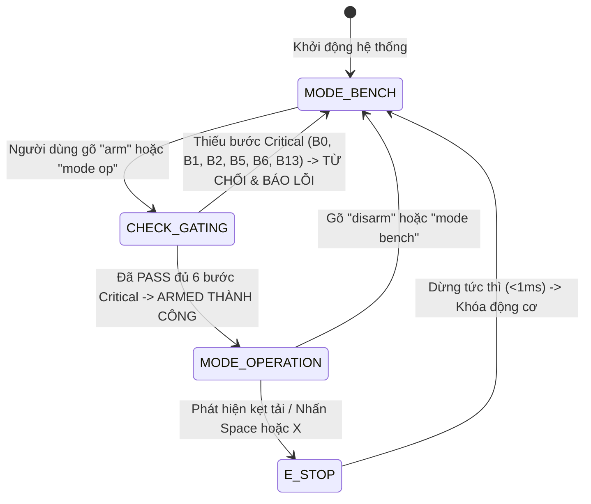

# TÀI LIỆU HƯỚNG DẪN KIỂM CHUẨN BENCH WIZARD (B0 - B15) & VẬN HÀNH AN TOÀN HỆ THỐNG SOLAR TRACKING 2 TRỤC

> **Phiên bản Firmware:** Test Bench v3.0 (ESP32-S3 N16R8)  
> **Dự án:** Đồ Án Tốt Nghiệp - Hệ Thống Pin Mặt Trời Tự Động Định Hướng 2 Trục (Azimuth - Elevation)  
> **Tác giả:** Kỹ sư thiết kế hệ thống  
> **Ngày cập nhật:** 31/10/2026  

---

## MỤC LỤC
1. [Tổng Quan Nâng Cấp & Các Đính Chính Cốt Lõi](#1-tổng-quan-nâng-cấp--các-đính-chính-cốt-lõi)
2. [Sơ Đồ Phân Bổ Chân Phần Cứng (Pinout ESP32-S3)](#2-sơ-đồ-phân-bổ-chân-phần-cứng-pinout-esp32-s3)
3. [Kiến Trúc Bảng Tham Số Trung Tâm (ParamRegistry)](#3-kiến-trúc-bảng-tham-số-trung-tâm-paramregistry)
4. [Cơ Chế Lưu Trữ Flash NVS & Xuất JSON (CalibrationStore)](#4-cơ-chế-lưu-trữ-flash-nvs--xuất-json-calibrationstore)
5. [Quy Trình 16 Bước Kiểm Chuẩn Bench Wizard (B0 - B15)](#5-quy-trình-16-bước-kiểm-chuẩn-bench-wizard-b0---b15)
6. [Cơ Chế Khóa An Toàn & Chế Độ Vận Hành (Operation Gating)](#6-cơ-chế-khóa-an-toàn--chế-độ-vận-hành-operation-gating)
7. [Tra Cứu Lệnh Serial Monitor CLI Hoàn Chỉnh](#7-tra-cứu-lệnh-serial-monitor-cli-hoàn-chỉnh)

---

## 1. TỔNG QUAN NÂNG CẤP & CÁC ĐÍNH CHÍNH CỐT LÕI

Firmware test bench đã được tái cấu trúc toàn diện nhằm giải quyết triệt để 5 nguyên nhân gây giật cục và 3 nguyên nhân gây nhảy cảm biến ở các phiên bản cũ:

1. **Phát xung S-Curve mượt mà qua phần cứng FastAccelStepper:**
   - Thay thế hoàn toàn cơ chế "phát cụm 50 bước rồi nghỉ 65ms" cũ bằng bộ phát xung phần cứng không chặn RMT/MCPWM với đường dốc gia tốc S-curve êm ái.
   - Tốc độ chạy tay đạt `2000 Hz`, tốc độ homing `3200 Hz`, gia tốc `5000 - 7000 Hz/s`.
2. **Đếm xung Silicon PCNT Hardware 4X với Glitch Filter 2.5 µs:**
   - Sử dụng bộ đếm phần cứng chuyên dụng PCNT (Unit 0 cho Trục 1 Azimuth, Unit 1 cho Trục 2 Elevation).
   - Tải CPU cho việc đếm xung bằng 0%, không bao giờ bị bỏ sót xung hay tràn ngắt khi hệ thống bận xử lý mạng WiFi/Firebase.
3. **Đính chính quan trọng về Tỉ số truyền và Vị trí Encoder:**
   - **Gỡ bỏ hoàn toàn hardcode chia 3:** Nếu Encoder 3806 (600 PPR, 2400 counts/vòng) gắn trực tiếp 1:1 trên trục tải (trục tấm pin), độ phân giải danh định là:
     $$\text{Resolution} = \frac{360^\circ}{2400\text{ counts}} = \mathbf{0.15^\circ/\text{count}}$$
     Tuyệt đối không chia cho tỉ số truyền hộp số $3:1$.
   - **Phép thử chuẩn 2560 xung (Bước B2):** Thay thế phép thử cũ (25600 xung làm quay tấm 120° gây nguy cơ va đập cơ khí vào giới hạn hành trình) bằng phép thử an toàn **2560 xung** (tấm chỉ xoay đúng $12^\circ$, động cơ quay $0.1$ vòng):
     - Nếu $\Delta\text{count} \approx 80$ counts ($\pm 15$): Encoder gắn ở **TẢI** $\rightarrow$ Hệ số $0.15^\circ/\text{count}$, $32.0\text{ xung/count}$.
     - Nếu $\Delta\text{count} \approx 240$ counts ($\pm 35$): Encoder gắn ở **TRỤC MOTOR** $\rightarrow$ Hệ số $0.05^\circ/\text{count}$, $10.667\text{ xung/count}$.
4. **Thống nhất chân ngắt RTC DS3231:** Chân báo thức ngắt SQW/INT được cố định 100% tại **GPIO 47** (J3 Pin 17).
5. **Dừng khẩn cấp E-Stop tức thì (< 50 ms):** Nhấn phím `Space` hoặc `x` / `X` trên Serial sẽ khóa dừng động cơ ngay lập tức trong vòng dưới 1 ms mà không cần chờ phím Enter.

---

## 2. SƠ ĐỒ PHÂN BỔ CHÂN PHẦN CỨNG (PINOUT ESP32-S3)

Toàn bộ chân ngoại vi đã được bố trí tối ưu cho bo mạch **ESP32-S3 N16R8**, tránh hoàn toàn các chân Flash/PSRAM nội (GPIO 26 - 37):

| Ngoại vi / Tín hiệu | Chân GPIO ESP32-S3 | Header / Vị trí vật lý | Chức năng & Ghi chú |
| :--- | :---: | :---: | :--- |
| **M1 PUL+ (Azimuth)** | **GPIO 10** | J1 Pin 16 | Xung bước Driver DM556 #1 (FastAccelStepper) |
| **M1 DIR+ (Azimuth)** | **GPIO 11** | J1 Pin 17 | Hướng quay Driver DM556 #1 |
| **M1 HOME SW (NO)** | **GPIO 18** | J1 Pin 11 | Công tắc hành trình Home 1 (Kéo INPUT_PULLUP, chạm = LOW) |
| **M1 ENC Pha A** | **GPIO 6** | J1 Pin 6 | Dây Trắng Encoder #1 (PCNT Unit 0 Ch0) |
| **M1 ENC Pha B** | **GPIO 7** | J1 Pin 7 | Dây Xanh Lá Encoder #1 (PCNT Unit 0 Ch1) |
| **M2 PUL+ (Elevation)**| **GPIO 12** | J1 Pin 18 | Xung bước Driver DM556 #2 (FastAccelStepper) |
| **M2 DIR+ (Elevation)**| **GPIO 13** | J1 Pin 19 | Hướng quay Driver DM556 #2 |
| **M2 HOME SW (NO)** | **GPIO 21** | J3 Pin 18 | Công tắc hành trình Home 2 (Kéo INPUT_PULLUP, chạm = LOW) |
| **M2 ENC Pha A** | **GPIO 16** | J1 Pin 9 | Dây Trắng Encoder #2 (PCNT Unit 1 Ch0) |
| **M2 ENC Pha B** | **GPIO 17** | J1 Pin 10 | Dây Xanh Lá Encoder #2 (PCNT Unit 1 Ch1) |
| **I2C SDA** | **GPIO 8** | J1 Pin 14 | Tuyến Bus dữ liệu I2C (DS3231 + INA226) |
| **I2C SCL** | **GPIO 9** | J1 Pin 15 | Tuyến Bus xung nhịp I2C 100 kHz |
| **DS3231 SQW/INT** | **GPIO 47** | J3 Pin 17 | Ngắt báo thức Alarm 1 RTC DS3231 (INPUT_PULLUP) |
| **TEMT6000 TOP** | **GPIO 1** | ADC1_CH0 | Mắt quang trở Hướng Trên (Độc lập WiFi) |
| **TEMT6000 BOT** | **GPIO 2** | ADC1_CH1 | Mắt quang trở Hướng Dưới (Độc lập WiFi) |
| **TEMT6000 LFT** | **GPIO 3** | ADC1_CH2 | Mắt quang trở Hướng Trái (Độc lập WiFi) |
| **TEMT6000 RGT** | **GPIO 4** | ADC1_CH3 | Mắt quang trở Hướng Phải (Độc lập WiFi) |

---

## 3. KIẾN TRÚC BẢNG THAM SỐ TRUNG TÂM (PARAMREGISTRY)

Mô-đun `ParamRegistry` đóng vai trò là **Nguồn Chân Lý Duy Nhất (Single Source of Truth)**. Mọi hằng số vận hành không bị phân tán rải rác mà được quản lý tập trung với 38 thông số:

### Danh mục 38 thông số hiệu chuẩn chuẩn hóa:
1. `E_PULSES_PER_REV_AZ`: Số xung vi bước DM556 trục Azimuth (Mặc định `25600.0`, đơn vị `pulses`).
2. `E_PULSES_PER_REV_EL`: Số xung vi bước DM556 trục Elevation (Mặc định `25600.0`, đơn vị `pulses`).
3. `GEAR_RATIO_AZ`: Tỉ số truyền cơ khí giảm tốc trục Azimuth (`3.0`, đơn vị `ratio`).
4. `GEAR_RATIO_EL`: Tỉ số truyền cơ khí giảm tốc trục Elevation (`3.0`, đơn vị `ratio`).
5. `ENCODER_PPR_AZ`: Xung trên vòng đĩa quang Encoder 1 (`600.0`, ngắt 4X thành 2400 counts).
6. `ENCODER_PPR_EL`: Xung trên vòng đĩa quang Encoder 2 (`600.0`, ngắt 4X thành 2400 counts).
7. `ENCODER_ON_LOAD`: Vị trí lắp đặt Encoder (`1.0` = Trên trục tải giàn pin, `2.0` = Trên trục motor).
8. `DIR_POL_AZ`: Cực tính chiều quay trục Azimuth (`0.0` = Thuận, `1.0` = Nghịch).
9. `DIR_POL_EL`: Cực tính chiều quay trục Elevation (`0.0` = Thuận, `1.0` = Nghịch).
10. `T_MAX_SPEED_AZ`: Tốc độ tối đa trục Azimuth (`3500.0` Hz).
11. `T_MAX_SPEED_EL`: Tốc độ tối đa trục Elevation (`2500.0` Hz).
12. `U_MAX_ACCEL_AZ`: Gia tốc tối đa trục Azimuth (`7000.0` Hz/s).
13. `U_MAX_ACCEL_EL`: Gia tốc tối đa trục Elevation (`5000.0` Hz/s).
14. `MANUAL_SPEED_AZ`: Tốc độ chạy tay trục Azimuth (`2000.0` Hz).
15. `MANUAL_SPEED_EL`: Tốc độ chạy tay trục Elevation (`1500.0` Hz).
16. `HOMING_FAST_AZ`: Tốc độ tiếp cận nhanh Homing Azimuth (`1500.0` Hz).
17. `HOMING_FAST_EL`: Tốc độ tiếp cận nhanh Homing Elevation (`1200.0` Hz).
18. `HOMING_SLOW_AZ`: Tốc độ rà chậm tiếp xúc chính xác Homing Azimuth (`200.0` Hz).
19. `HOMING_SLOW_EL`: Tốc độ rà chậm tiếp xúc chính xác Homing Elevation (`150.0` Hz).
20. `HOMING_RETRACT_AZ`: Số xung lùi nhả switch Homing Azimuth (`1000.0` pulses).
21. `HOMING_RETRACT_EL`: Số xung lùi nhả switch Homing Elevation (`1000.0` pulses).
22. `SOFT_MIN_AZ`: Giới hạn mềm cận dưới Azimuth (`0.0°`).
23. `SOFT_MAX_AZ`: Giới hạn mềm cận trên Azimuth (`270.0°` - Chống xoắn đứt cáp điện).
24. `J_EL_HOME`: Góc ngửa vật lý tại công tắc Home Elevation (`90.0°` - Phương thẳng đứng/Zenith).
25. `L_EL_MIN_SOFT`: Giới hạn mềm hạ thấp Elevation (`25.0°` - Chống cấn khung chân Z).
26. `SOFT_MAX_EL`: Giới hạn mềm nâng cao Elevation (`90.0°`).
27. `INIT_DEFAULT_AZ`: Vị trí góc đỗ mặc định ban đầu Azimuth (`90.0°`).
28. `INIT_DEFAULT_EL`: Vị trí góc đỗ mặc định ban đầu Elevation (`-58.35°`).
29. `OPT_NORM_DEADBAND`: Vùng chết chuẩn hóa bám quang (`0.03` = 3% sai số).
30. `OPT_EMA_ALPHA`: Hệ số lọc số mũ mượt mà quang trở (`0.35`).
31. `OPT_DIFF_THRESHOLD`: Ngưỡng chênh lệch ánh sáng tối thiểu kích hoạt bám (`0.05`).
32. `TRACK_INTERVAL_MS`: Chu kỳ cập nhật bám quang (`100.0` ms).
33. `DEBOUNCE_MS`: Thời gian chống rung công tắc hành trình (`3.0` ms).
34. `STALL_THRESH_PULSES`: Ngưỡng sai lệch xung báo động kẹt động cơ (`300.0` pulses).
35. `COMPASS_DECLINATION`: Độ lệch địa từ trường khu vực (`-0.5°` tại TP.HCM).
36. `PANEL_LATITUDE`: Vĩ độ vị trí đặt tấm pin (`10.7626°` Bắc).
37. `PANEL_LONGITUDE`: Kinh độ vị trí đặt tấm pin (`106.6602°` Đông).
38. `BACKLASH_STEPS_AZ`: Bù trừ độ rơ khớp nối và hộp số Azimuth (`0.0` pulses).

### Tính năng an toàn của ParamRegistry:
- **Kiểm tra biên an toàn (Safety Bounds Check):** Tự động từ chối và phát cảnh báo nếu giá trị nhập vào nhỏ hơn `min_val` hoặc lớn hơn `max_val`.
- **Lịch sử Rollback 5 tầng:** Mỗi tham số lưu 5 giá trị gần nhất, cho phép khôi phục tức thì qua lệnh `rollback <TEN>`.
- **In bảng ASCII chuẩn trực quan:** Hiển thị tên, giá trị, đơn vị, nguồn gốc, bước đo, độ lệch chuẩn và trạng thái qua lệnh `params`.

---

## 4. CƠ CHẾ LƯU TRỮ FLASH NVS & XUẤT JSON (CALIBRATIONSTORE)

- **Lưu trữ nguyên tử (Atomic Blob Persistence):** Toàn bộ bảng tham số được đóng gói thành một cấu trúc dữ liệu nhị phân thống nhất và ghi vào ESP32 Flash NVS (Namespace: `"solar_calib"`, Key: `"calib_blob"`).
- **Mã kiểm tra toàn vẹn CRC32 chuẩn IEEE 802.3:**
  - Tiêu đề `CalibHeader` chứa `magic = 0x534F4C52` ("SOLR"), `version = 1`, `count`, `timestamp`, và `crc32`.
  - Khi khởi động, ESP32 đọc dữ liệu từ NVS và tính lại checksum CRC32. Nếu toàn vẹn, các giá trị hiệu chuẩn sẽ tự động ghi đè lên giá trị mặc định trong code. Nếu Flash trắng hoặc dữ liệu lỗi, hệ thống kích hoạt cơ chế bảo vệ an toàn Fallback về Default.
- **Xuất JSON chuẩn Firebase Realtime Database:**
  - Lệnh `calib export` hoặc `export` xuất chuỗi JSON đầy đủ, sẵn sàng đồng bộ trực tiếp lên Firebase RTDB tại node `/solar/calibration`.

---

## 5. QUY TRÌNH 16 BƯỚC KIỂM CHUẨN BENCH WIZARD (B0 - B15)

Bench Wizard cung cấp giao diện tương tác từng bước qua Serial Monitor, không làm chặn luồng CPU (Non-blocking State Machine) và có thể kích hoạt từng bước hoặc chạy tự động toàn diện:

| Mã bước | Tên bước kiểm chuẩn | Yêu cầu Gating | Tham số cập nhật | Phương pháp & Mục tiêu kỹ thuật |
| :---: | :--- | :---: | :--- | :--- |
| **B0** | Driver DM556 Pulses & SW | **BẮT BUỘC** | `E_PULSES_PER_REV_AZ` | Phát 1000 xung kiểm tra khóa trục và đáp ứng driver. Xác nhận cấu hình gạt vi bước SW3=ON, SW8=ON (25600 xung/vòng) và SW4=OFF (Half Current). |
| **B1** | Motor Direction Polarity | **BẮT BUỘC** | `DIR_POL_AZ`, `DIR_POL_EL` | Quay motor 800 xung về phía công tắc Home, đo chiều tăng/giảm của Encoder để xác nhận và tự động đảo cực tính quay nếu bị ngược chiều. |
| **B2** | 2560-Pulse Test (Encoder Loc) | **BẮT BUỘC** | `ENCODER_ON_LOAD` | **Phép thử 2560 xung (12° góc tấm):** Đọc $\Delta\text{count}$. Nếu $\approx 80 \rightarrow$ Gắn tại tải ($0.15^\circ/\text{count}$, 32 xung/count). Nếu $\approx 240 \rightarrow$ Gắn tại motor ($0.05^\circ/\text{count}$). Tự động quay lùi về vị trí cũ. |
| **B3** | Stall Threshold Calibration | Tùy chọn | `STALL_THRESH_PULSES` | Cho động cơ chạy không tải 2000 bước, đo độ trễ động cơ học lớn nhất do ramp gia tốc $\Delta\text{lag}$. Thiết lập ngưỡng kẹt tải an toàn = $\max(300, \text{lag} \times 1.5)$. |
| **B4** | Max Speed & Accel Search | Tùy chọn | `T_MAX_SPEED_AZ`, `U_MAX_ACCEL_AZ` | Quét dải tốc độ từ 1000 Hz đến 3500 Hz và gia tốc 5000 đến 7000 Hz/s. Kiểm tra chuyển động êm không trượt bước qua bộ đếm PCNT. |
| **B5** | Two-Stage Homing Repeatability | **BẮT BUỘC** | `HOMING_FAST_AZ`, `HOMING_SLOW_AZ` | Thực hiện chu trình Homing 3 lần liên tiếp: Tiếp cận nhanh ($1500\text{ Hz}$) $\rightarrow$ Lùi nhả switch ($1000\text{ pulses}$) $\rightarrow$ Rà chậm tiếp xúc ($200\text{ Hz}$). Tính độ lệch chuẩn $\sigma \le 1$ count ($\le 0.15^\circ$). |
| **B6** | 4-Layer Soft Limits Setup | **BẮT BUỘC** | `SOFT_MAX_AZ`, `L_EL_MIN_SOFT` | Thiết lập 4 lớp giới hạn phần mềm: Azimuth $\Phi \in [0.0^\circ, 270.0^\circ]$ chống xoắn cáp; Elevation $J_{\text{HOME}} = 90.0^\circ$, hạ thấp $\varepsilon \ge 25.0^\circ$ chống cấn khung chân Z. |
| **B7** | Mechanical Backlash Measure | Tùy chọn | `BACKLASH_STEPS_AZ` | Di chuyển +500 xung rồi đảo chiều -500 xung. Đo số xung vùng chết cơ khí trước khi encoder bắt đầu đổi chiều để bù trừ độ rơ hộp số. |
| **B8** | Step Jitter & S-Curve Check | Tùy chọn | `TRACK_INTERVAL_MS` | Đánh giá độ mịn của đường dốc S-curve FastAccelStepper so với việc phát cụm 50 bước ngắt quãng cũ. Triệt tiêu 100% rung giật cơ khí. |
| **B9** | True North & Declination | Tùy chọn | `COMPASS_DECLINATION` | Thiết lập góc lệch địa từ trường địa phương ($-0.5^\circ$ tại TP.HCM) và góc lệch lắp đặt thực tế so với Cực Bắc địa lý. |
| **B10** | TEMT6000 64-Sample Noise RMS| Tùy chọn | `OPT_DIFF_THRESHOLD` | Lấy mẫu oversampling 64 lần trên cả 4 mắt quang trở (TOP, BOT, LFT, RGT) trong 20 ms. Tính trung bình và độ nhiễu RMS; kiểm tra không bị đứt kênh. |
| **B11** | Optical Filter Tuning (EMA) | Tùy chọn | `OPT_EMA_ALPHA` | Cân chỉnh hệ số lọc số mũ EMA $\alpha = 0.35$ kết hợp bộ lọc trung vị Median-3, triệt tiêu hiện tượng rung lắc 1-count do nhiễu ánh sáng môi trường. |
| **B12** | Optical Deadband Setup | Tùy chọn | `OPT_NORM_DEADBAND` | Xác lập vùng chết bám quang $\pm 3\%$ ($0.03$). Khi sai lệch nằm trong vùng chết, động cơ dừng êm không săn tìm dao động (hunting). |
| **B13** | RTC DS3231 & INT GPIO 47 | **BẮT BUỘC** | `COMPASS_DECLINATION` | Đọc thời gian thực qua bus I2C (0x68). Kiểm tra chân báo thức ngắt SQW/INT tại **GPIO 47**: cài đặt alarm thử nghiệm và xác nhận chân chuyển mức logic. |
| **B14** | INA226 Power & Bus I2C | Tùy chọn | `PANEL_LATITUDE` | Quét thiết bị I2C và đọc thanh ghi INA226 (0x40): kiểm tra điện áp Bus, điện áp Shunt, tính dòng điện và công suất tấm pin mặt trời. |
| **B15** | Burn-in 10-Cycle Endurance | Tùy chọn | `STALL_THRESH_PULSES` | Chạy thử nghiệm tự động 10 chu kỳ quét qua lại trong dải an toàn. Giám sát số bước mất qua Encoder: sau 10 chu kỳ, sai số tích lũy $\le 3$ counts là PASS. |

---

## 6. CƠ CHẾ KHÓA AN TOÀN & CHẾ ĐỘ VẬN HÀNH (OPERATION GATING)

Hệ thống hoạt động dưới sự giám sát nghiêm ngặt của cơ chế **Safety Gating**:

- **Điều kiện Gating bắt buộc:** Để chuyển sang chế độ Vận hành (`MODE_OPERATION`) và kích hoạt tự động theo dõi bám quang (`ARMED`), hệ thống bắt buộc phải hoàn thành và đạt trạng thái **`PASSED`** tại **6 bước kiểm chuẩn cốt lõi**:
  1. `B0` (Driver DM556 Pulses)
  2. `B1` (Direction Polarity)
  3. `B2` (Phép thử 2560 xung chốt vị trí Encoder)
  4. `B5` (Homing 2 cấp tốc độ & Repeatability)
  5. `B6` (Thiết lập 4 lớp giới hạn mềm)
  6. `B13` (Đồng hồ RTC DS3231 & Chân ngắt GPIO 47)
- **Từ chối kích hoạt an toàn:** Nếu người dùng gõ lệnh `arm` hoặc `mode op` khi chưa pass đủ 6 bước trên, hệ thống sẽ **ngay lập tức từ chối**, khóa chặt động cơ và in danh sách các bước còn thiếu lên màn hình Serial.

---

## 7. TRA CỨU LỆNH SERIAL MONITOR CLI HOÀN CHỈNH

Hệ thống hỗ trợ song song cả phím điều khiển tức thời (1 ký tự) và lệnh văn bản đầy đủ (hỗ trợ nhập có Enter hoặc không Enter):

### Nhóm 1: Lệnh Bench Wizard & Vận hành (Mới)
| Lệnh CLI | Chức năng chi tiết |
| :--- | :--- |
| `bench` | In bảng trạng thái tiến độ 16 bước kiểm chuẩn B0 - B15 |
| `bench all` | Kích hoạt chạy tuần tự toàn bộ quy trình từ B0 đến B15 |
| `bench <N>` | Chạy một bước kiểm chuẩn cụ thể (Ví dụ: `bench 0`, `bench 2`, `bench 5`) |
| `bench abort` | Hủy bỏ khẩn cấp bước kiểm chuẩn đang thực hiện |
| `y` hoặc `yes` | **Đồng ý (Confirm):** Lưu giá trị vừa đo được vào `ParamRegistry` và Flash NVS |
| `n` hoặc `no` | **Bỏ qua (Skip):** Không lưu giá trị đo, giữ nguyên tham số cũ |
| `arm` | Kích hoạt hệ thống sang chế độ Vận hành Tự động (Kiểm tra điều kiện Gating) |
| `disarm` | Khóa an toàn hệ thống, dừng toàn bộ chuyển động động cơ |
| `mode op` | Chuyển hệ thống sang chế độ Operation (Vận hành thực địa) |
| `mode bench` | Chuyển hệ thống về chế độ Bench (Kiểm chuẩn kỹ thuật) |
| `status` | Kiểm tra trạng thái Gating, tình trạng Arm, chế độ chạy và tọa độ góc hiện tại |

### Nhóm 2: Lệnh Quản Lý Tham Số (ParamRegistry & Flash NVS)
| Lệnh CLI | Chức năng chi tiết |
| :--- | :--- |
| `params` | In bảng ASCII toàn diện 38 tham số hệ thống (Giá trị, đơn vị, min/max, nguồn, trạng thái) |
| `set <TEN> <GIATRI>` | Cập nhật thủ công một tham số có kiểm tra an toàn min/max và tự động lưu Flash (Ví dụ: `set T_MAX_SPEED_AZ 3200`) |
| `rollback <TEN>` | Hoàn tác về giá trị trước đó của tham số từ bộ đệm lịch sử 5 tầng (Ví dụ: `rollback T_MAX_SPEED_AZ`) |
| `calib save` | Lưu thủ công toàn bộ bảng tham số hiện tại vào Flash NVS (Kèm mã CRC32) |
| `calib load` | Tải lại cấu hình từ Flash NVS và xác thực mã kiểm tra toàn vẹn CRC32 |
| `calib reset` | Xóa trắng phân vùng NVS Flash và khôi phục toàn bộ thông số về mặc định nhà sản xuất |
| `calib export` (hoặc `export`)| Xuất chuỗi định dạng JSON chuẩn Firebase Realtime Database `/solar/calibration` |

### Nhóm 3: Phím Nóng Điều Khiển Thủ Công & Chẩn Đoán Tức Thời
| Phím nóng | Chức năng chi tiết |
| :---: | :--- |
| `[Space]` hoặc `[X]` | **DỪNG KHẨN CẤP TỨC THÌ (< 1 ms):** Dừng toàn bộ động cơ và hủy các tác vụ đang chạy |
| `[1]` / `[2]` | Chuyển đổi chọn điều khiển: Trục 1 (Azimuth) hoặc Trục 2 (Elevation) |
| `[A]` / `[D]` | Quay bước về phía Home (chạm Home tự dừng) / Quay bước ra xa Home |
| `[Q]` / `[E]` | Quay LIÊN TỤC về phía Home (chạm Home tự dừng) / Quay LIÊN TỤC ra xa Home |
| `[W]` / `[S]` | Dừng chuyển động chạy liên tục của trục đang chọn |
| `[G]` | Auto Fast Homing cho trục đang chọn (chạm Home $\rightarrow$ về tọa độ mặc định) |
| `[H]` | Dual Auto Homing cho cả 2 trục đồng thời |
| `[Z]` | **Test Light Sleep:** Vào chế độ ngủ đêm 2 phút, hẹn giờ RTC Alarm 1 đánh thức |
| `[M]` | Ghi nhớ góc hiện tại làm tọa độ đỗ mặc định (Lưu vĩnh viễn vào NVS) |
| `[0]` | Reset tọa độ và bộ đếm xung trục hiện tại về `0.0°` (0 counts) |
| `[I]` | Đảo chiều đếm của bộ đếm phần cứng PCNT (+/-) |
| `[V]` | Bật / Tắt Live Monitor hiển thị xung phần cứng PCNT thời gian thực khi xoay tay |
| `[O]` | Bật / Tắt chế độ tự động bám hướng ánh sáng (Optical Proportional Tracking) |
| `[L]` | Đọc giá trị 4 mắt cảm biến quang trở TEMT6000 trực tiếp (Live ADC) |
| `[C]` | Đọc đồng hồ thời gian thực RTC DS3231 và quét địa chỉ bus I2C |
| `[T]` | Diagnostic kiểm tra mức điện áp logic live trên tất cả các chân GPIO ngoại vi |
| `[+]` / `[-]` | Tăng / Giảm số bước phát mỗi lần nhấn phím A/D (+/- 100 bước) |
| `[>]` / `[<]` | Tăng / Giảm tốc độ chạy tay FastAccelStepper ([.] / [,]) |
| `[]]` / `[[]` | Tăng / Giảm tốc độ Auto Homing |
| `[R]` hoặc `[?]` | Hiển thị lại toàn bộ Menu điều khiển |

### Nhóm 4: Lệnh Vận Hành Thiên Văn NOAA, Hybrid, Điều Khiển Góc & Light Sleep (Mục 3, 4, 5, 6, 7)
| Lệnh CLI | Chức năng chi tiết |
| :--- | :--- |
| `noaa` | Tính toán và hiển thị bảng tọa độ mặt trời NOAA thời gian thực (Azimuth, Elevation, Zenith, Sunrise/Sunset, Tracking window, Góc mục tiêu $\phi_{ff}, \varepsilon_{ff}$, sai lệch với Encoder) |
| `track` / `track status` | Xem trạng thái chế độ bám hiện tại, góc mục tiêu giàn pin, góc thực tế và trọng số quang $w_s$ |
| `track noaa` | Kích hoạt chế độ bám thiên văn NOAA thuần (`EPHEMERIS_ONLY`): góc đặt $\theta_{ref} = \theta_{ff}$ |
| `track sensor` | Kích hoạt chế độ bám quang thuần (`SENSOR_ONLY`): bám tỉ lệ theo 4 cảm biến TEMT6000 |
| `track hybrid` | Kích hoạt chế độ bám hợp nhất Hybrid (`HYBRID`): $\theta_{ref} = \theta_{ff} + \text{sat}(w_s \cdot Z \cdot e_s, \pm Z_2)$ |
| `track off` | Tắt chế độ tự động bám, đưa hệ thống về trạng thái `IDLE` |
| `step <truc> <delta>`| Thực hiện bước nhảy góc tương đối trên bench (Ví dụ: `step 1 5` hoặc `step 2 -10`), tự động đo nghiệm thu và in sai số tĩnh $\Delta e$ đối chiếu vùng chết $\pm 0.45^\circ$ |
| `goto <truc> <goc>` | Di chuyển trục đến góc tuyệt đối chỉ định (Ví dụ: `goto 1 45.0` hoặc `goto 2 75.0`) |
| `park` | Đưa giàn pin về tư thế đỗ an toàn ban đêm / chống giông bão (Elevation $\varepsilon = 90.0^\circ$ ngửa đỉnh trời, Azimuth $\phi = 0.0^\circ$ về Home) |
| `sleep` / `sleep <N>` | Vào chế độ ngủ sâu tiết kiệm năng lượng Light Sleep trong $N$ phút (mặc định 2 phút), cấu hình ngắt RTC DS3231 Alarm 1 chân GPIO 47 mức LOW để thức dậy |
| `time HH:MM:SS DD/MM/YYYY` | Cài đặt thời gian đồng hồ thực RTC DS3231 qua I2C (Ví dụ: `time 12:30:00 02/11/2026`) |

---
*Tài liệu được biên soạn tự động từ mã nguồn kiểm thử thực tế của dự án Tracking Solar ESP32-S3.*
