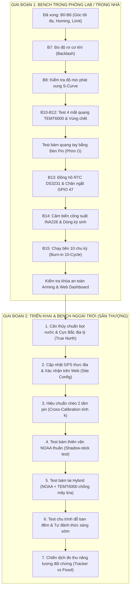

# KẾ HOẠCH & DANH MỤC CÁC BƯỚC BENCH TEST (TRONG NHÀ & NGOÀI TRỜI)
## ĐỒ ÁN TỐT NGHIỆP: HỆ THỐNG GIÁM SÁT & ĐIỀU KHIỂN SOLAR TRACKER 2 TRỤC (ESP32-S3)

> **Tình trạng hiện tại:** Đã cài đặt xong **Góc giới hạn tối đa / Giới hạn mềm** (Soft Limits - Bước B6 trong Bench Wizard).  
> **Tài liệu tham chiếu:** [BENCH_AND_OPERATION_MANUAL.md](file:///d:/ĐỒ%20ÁN%20TỐT%20NGHIỆP/BENCH_AND_OPERATION_MANUAL.md), [PRE_EXPERIMENT_CHECKLIST.md](file:///d:/ĐỒ%20ÁN%20TỐT%20NGHIỆP/docs/PRE_EXPERIMENT_CHECKLIST.md), [DANH_SACH_HANG_SO_VA_THAM_SO_CAN_DO.md](file:///d:/ĐỒ%20ÁN%20TỐT%20NGHIỆP/DANH_SACH_HANG_SO_VA_THAM_SO_CAN_DO.md).

---

## 🧭 LỘ TRÌNH TỔNG QUAN

---

# PHẦN I: DANH MỤC BENCH TIẾP THEO TRONG NHÀ (INDOOR LAB BENCH)

Mục tiêu trong nhà là **kiểm tra độ an toàn 100%, độ mịn, các cảm biến quang/điện/thời gian và khóa Gating** trước khi vác phần cứng ra phơi nắng gió ngoài trời.

---

### Bước 1: Đo độ rơ cơ khí & khớp nối (B7 - Mechanical Backlash Measure)
* **Ý nghĩa:** Khi động cơ đảo chiều (Đông sang Tây rồi quay ngược lại), hộp số 3:1 và khớp nối trục luôn có một khoảng chết cơ khí. Cần đo số xung trễ này để firmware tự động bù trừ.
* **Cách thực hiện trên Serial Monitor:**
  1. Gõ lệnh: `bench 7`
  2. Hoặc jog thủ công: Cho trục quay tới +500 xung, sau đó phát lệnh quay ngược lại -500 xung.
  3. Quan sát bộ đếm phần cứng PCNT trên Serial: Ghi nhận số xung động cơ phát đi trước khi Encoder bắt đầu đếm lùi.
* **Tiêu chuẩn nghiệm thu:** Độ rơ $\le 15$ xung ($\le 0.07^\circ$). Nếu lớn hơn, cần siết lại ốc cọc giữ khớp nối đệm mềm hoặc pulley.

---

### Bước 2: Kiểm tra độ mịn phát xung S-Curve & triệt tiêu rung giật (B8)
* **Ý nghĩa:** Đảm bảo thư viện phần cứng FastAccelStepper hoạt động trơn tru với đường dốc gia tốc S-curve, không giật cụm như code cũ làm lỏng ốc khung giàn.
* **Cách thực hiện:**
  1. Gõ lệnh: `bench 8`
  2. Hoặc dùng phím `[` và `]` tăng giảm tốc độ, phím `A`/`D` quay bước.
  3. Lắng nghe tiếng rít động cơ và sờ tay vào khung nhôm: Động cơ phải tăng tốc êm, dừng lại có giảm tốc (deceleration) mượt mà, không nghe tiếng "cục cục" hay giật khung giàn.

---

### Bước 3: Kiểm tra 4 mắt cảm biến quang TEMT6000 & Cân chỉnh vùng chết (B10, B11, B12)
* **Dụng cụ cần chuẩn bị:** 01 Đèn pin LED hoặc đèn Flash điện thoại.
* **Nội dung kiểm tra:**
  1. **Bước B10 (Noise RMS & Dải đo):**
     * Gõ lệnh `bench 10` hoặc nhấn phím **`L`** (Live ADC).
     * Xem giá trị 4 mắt: `TOP`, `BOT`, `LFT`, `RGT`.
     * Khi để trong phòng bình thường: ADC đo được khoảng $400 - 1500$.
     * Lấy tay che tối hoàn toàn cụm cảm biến: ADC phải rớt xuống dưới $400$ ($T_{dark}$).
     * Lấy đèn pin rọi sát trực tiếp: ADC phải nhảy lên dải cao $3500 - 3950$ (ngưỡng bão hòa $W_{sat}$). Đảm bảo không kênh nào bị kẹt $0$ hoặc đứt dây.
  2. **Bước B11 (Lọc số EMA & Chống rung 1-count):**
     * Gõ lệnh `bench 11`: Xác nhận hệ số lọc $\alpha = 0.35$.
     * Đưa đèn pin qua lại chậm rãi: Giá trị quang biến thiên liên tục, không bị nhảy số ngắt quãng.
  3. **Bước B12 (Vùng chết - Deadband 3%):**
     * Gõ lệnh `bench 12`: Đặt `OPT_NORM_DEADBAND = 0.03`.
     * Rọi đèn pin vào chính giữa tim chữ thập: Sai số chênh lệch $(L-R)/(L+R)$ và $(T-B)/(T+B)$ lọt vào vùng chết $\pm 3\%$, động cơ không bị rung giật tìm kiếm (hunting).

---

### Bước 4: Test thực nghiệm chế độ Bám Quang Tự Động bằng Đèn Pin (Optical Tracking Live)
* **Cách thực hiện:**
  1. Đặt giàn pin ở vị trí giữa dải an toàn (xa công tắc Home).
  2. Trên Serial Monitor, nhấn phím **`O`** (chữ O hoa) để kích hoạt `OPTICAL TRACKING: ON`.
  3. Cầm đèn pin rọi lệch sang bên Trái: Giàn pin phải tự xoay động cơ theo hướng đèn pin.
  4. Rọi đèn chếch lên Trên: Trục ngửa Elevation phải ngửa lên đón nguồn sáng.
  5. Đưa đèn vào chính giữa: Cả 2 động cơ tự động dừng êm ru.
  6. **Test E-Stop an toàn:** Khi giàn đang quay theo đèn, lập tức nhấn phím **`Space`** (hoặc gõ `x`) $\rightarrow$ Toàn bộ động cơ phải khựng dừng ngay lập tức trong vòng $< 1\text{ ms}$!

---

### Bước 5: Kiểm tra RTC DS3231, Pin CR2032 & Ngắt báo thức GPIO 47 (B13 - BẮT BUỘC ĐỂ ARM)
* **Ý nghĩa:** Đây là bước Critical cuối cùng để mở khóa hệ thống sang chế độ vận hành.
* **Cách thực hiện:**
  1. Gõ lệnh: `bench 13` hoặc nhấn phím **`C`**.
  2. Kiểm tra đọc giờ RTC qua I2C: Màn hình phải hiện ngày, tháng, năm, giờ, phút, giây chuẩn xác và nhiệt độ chip DS3231.
  3. **Test chân ngắt SQW/INT (GPIO 47):** Kiểm tra trạng thái mức logic chân GPIO 47. Cài đặt báo thức thử nghiệm xem ngắt có kéo về LOW đúng cách không.
  4. **Test pin nuôi CR2032:** Rút nguồn cấp USB/Buck ra khoảng 1-2 phút, cắm lại và nhấn `C`: Giờ phải tiếp tục chạy đúng mà không bị reset về 00:00:00 (cờ `OSF = 0`).

---

### Bước 6: Kiểm tra cảm biến INA226 & Đo dòng tiêu thụ ký sinh (B14)
* **Cách thực hiện:**
  1. Gõ lệnh: `bench 14`: Quét địa chỉ I2C `0x40` của INA226.
  2. Nối thử một nguồn tải nhỏ (hoặc tấm pin rọi đèn) qua chân Shunt của INA226: Kiểm tra hiển thị điện áp Bus ($V$), dòng tải ($mA$), và công suất ($mW$).
  3. **Đo công suất tự tiêu thụ (Parasitic Power):**
     * Đo dòng tiêu thụ toàn hệ thống khi 2 động cơ đứng yên (chế độ giữ torque): $I_{idle} \approx \_\_\_\_\text{ mA}$.
     * Đo dòng tiêu thụ khi cả 2 động cơ đang quay đồng thời: $I_{moving} \approx \_\_\_\_\text{ mA}$.
     * *Số liệu này rất quan trọng để đưa vào báo cáo và tính toán năng lượng tiêu hao $E_{parasitic}$!*

---

### Bước 7: Thử nghiệm chạy bền 10 chu kỳ liên tục (B15 - Burn-in Endurance Test)
* **Cách thực hiện:**
  1. Gõ lệnh: `bench 15`
  2. Hệ thống sẽ tự động điều khiển 2 trục chạy qua lại liên tục 10 chu kỳ trong phạm vi giới hạn mềm an toàn (Azimuth từ $30^\circ \to 240^\circ$, Elevation từ $30^\circ \to 80^\circ$).
  3. Sau khi kết thúc 10 chu kỳ, hệ thống đọc lại Encoder: Sai số lệch tọa độ tích lũy phải $\le 3$ counts ($\le 0.45^\circ$) $\rightarrow$ **PASS (Không trượt bước, dây đai không trượt)**.

---

### Bước 8: Kiểm tra khóa Arming & Đồng bộ Web Dashboard trong nhà
* **Cách thực hiện:**
  1. Gõ lệnh: `status` và `arm` trên Serial Monitor.
  2. Hệ thống phải thông báo: `>> ARMED THÀNH CÔNG! Chuyển sang MODE_OPERATION`. (Nếu còn báo thiếu bước nào, gõ `bench <bước_đó>` để hoàn tất).
  3. Mở file [Chay_Dashboard.bat](file:///d:/ĐỒ%20ÁN%20TỐT%20NGHIỆP/Chay_Dashboard.bat) để bật Web Dashboard:
     * Kiểm tra trạng thái kết nối Firebase RTDB: Báo xanh "ONLINE".
     * Kiểm tra hiển thị mô hình 3D / Tọa độ góc trên Web khớp với góc cơ khí thực tế của giàn.
     * Bấm thử các nút điều khiển Jog tay, Homing, Park trên Web xem ESP32 có nhận lệnh tức thì không.

---

# PHẦN II: DANH MỤC BENCH & THỰC NGHIỆM NGOÀI TRỜI (OUTDOOR FIELD EXPERIMENTS)

Khi mang hệ thống ra sân thượng / vị trí đón nắng thực tế, cần thực hiện tuần tự các bước kiểm chuẩn sau:

---

### 1. Cân Thủy Chuẩn & Định Hướng Cực Bắc Địa Lý (True North Leveling - B9)
* **Dụng cụ:** Thước thủy nivo bọt nước cân bằng, La bàn quân sự (hoặc app Compass trên điện thoại).
* **Nội dung thực hiện:**
  1. **Cân thăng bằng mặt đế:** Đặt thước nivo lên khung đế xoay, chêm chân cho bọt nước vào đúng tâm hình tròn. Nếu đế bị nghiêng, khi xoay quanh trục Azimuth góc Elevation sẽ bị sai lệch hình học.
  2. **Định hướng Cực Bắc:**
     * Tra cứu độ lệch từ thiên tại TP.HCM: $\delta \approx -0.5^\circ$.
     * Căn chỉnh trục giàn pin hoặc công tắc Home Azimuth sao cho mốc $0^\circ$ quay đúng về hướng Cực Bắc địa lý thật.
     * Cập nhật tham số nếu có độ lệch lắp đặt thực tế: lệnh `set COMPASS_DECLINATION -0.5`.

---

### 2. Cập nhật tọa độ GPS thực địa & Xác nhận trên Web (Site Config)
* **Cách thực hiện:**
  1. Mở Google Maps hoặc app GPS tại đúng vị trí đặt giàn trên sân thượng, ghi nhận vĩ độ ($A$) và kinh độ ($B$) với độ chính xác 5 chữ số thập phân (Ví dụ: `10.76260° N`, `106.66020° E`).
  2. Nhập tọa độ này vào Web Dashboard tại mục **Cài đặt Tọa độ Trạm (Site Config)**.
  3. Bấm nút **"Xác nhận Tọa độ Thực địa"** trên Dashboard $\rightarrow$ Web sẽ gửi bản tin Firebase với cờ `site_confirmed = true` xuống ESP32. ESP32 lưu vĩnh viễn vào Flash NVS để tính toán thuật toán NOAA.

---

### 3. Hiệu chuẩn chéo hai tấm pin (Cross-Calibration giữa Tấm Tracker và Tấm Cố Định)
* **Ý nghĩa khoa học:** Hai tấm pin dù cùng công suất danh định (ví dụ 50W) vẫn có sai số chế tạo ($2\% - 5\%$). Trước khi đo so sánh thu năng lượng, bắt buộc phải đo hiệu chuẩn chéo để lấy hệ số $k$.
* **Cách thực hiện:**
  1. Đặt **CẢ HAI TẤM PIN** ở trạng thái tĩnh cùng một góc cố định: Hướng chính Nam ($180^\circ$), nghiêng $15^\circ$ (độ ngửa $\varepsilon = 75^\circ$).
  2. Để hai tấm cạnh nhau, không che bóng lẫn nhau.
  3. Thu thập dữ liệu công suất và tích phân năng lượng ($Wh$) liên tục trong 1 ngày nắng trọn vẹn từ 07:00 đến 17:00:
     * Tổng năng lượng tấm 1 (trên Tracker): $E_{pv1}$
     * Tổng năng lượng tấm 2 (Tấm Cố Định): $E_{pv2}$
  4. Tính hệ số hiệu chỉnh:
     $$k = \frac{E_{pv2}}{E_{pv1}}$$
  5. Khi tiến hành thí nghiệm bám nhật động sau này, năng lượng thực tế thu thêm (độ lợi) sẽ tính theo công thức chuẩn:
     $$E_{\text{net}} = E_{\text{tracker}} \cdot k - E_{\text{fixed}} - E_{\text{parasitic}}$$

---

### 4. Kiểm thử bám theo Quỹ đạo Thiên văn Thuần túy (NOAA Pure Astronomical Tracking)
* **Cách thực hiện:**
  1. Chuyển chế độ điều khiển sang **NOAA Feedforward Only** (tạm ngắt cảm biến quang).
  2. Dùng phương pháp **Cọc đo bóng nắng (Shadow-stick test):**
     * Gắn một cọc thẳng đứng dài khoảng $5 - 10\text{ cm}$ vuông góc tại tâm mặt tấm pin.
     * Quan sát bóng đổ của cọc: Khi hệ thống bám đúng mặt trời theo thuật toán NOAA, bóng của cọc phải thu nhỏ lại thành một vòng tròn đồng tâm tại chân cọc (sai số góc bám $\le 1.0^\circ$).
  3. Quan sát giàn di chuyển bám nắng từng góc bước nhỏ theo chu kỳ thời gian (ví dụ mỗi $1 - 2$ phút bước một góc khoảng $0.25^\circ - 0.5^\circ$).

---

### 5. Kiểm thử bám lai Hybrid (NOAA + TEMT6000) & Khả năng chống "Mây Lừa"
* **Cách thực hiện:**
  1. Bật chế độ bám **Hybrid (2)**: ESP32 dùng NOAA tính góc chính, 4 mắt TEMT6000 thực hiện tinh chỉnh trong dải kẹp hẹp $\pm Z_2 = \pm 6^\circ$.
  2. **Thử nghiệm khi mây che khuất mặt trời:**
     * Quan sát khi trời nhiều mây hoặc bóng râm: Tổng cường độ 4 mắt quang tụt xuống dưới ngưỡng $T_{dark}$ ($400$ ADC).
     * Kiểm tra trạng thái hệ thống: Trọng số cảm biến $w_s$ phải tự động chuyển về $0.0$, hệ thống hoàn toàn dựa vào góc tính toán NOAA, **tuyệt đối không bị xoay loạn xạ theo các đám mây viền sáng**.
     * Khi mây tan, nắng chiếu lại: Hệ thống tự động nâng $w_s > 0$ và tinh chỉnh đón đúng tâm bức xạ rực rỡ nhất.

---

### 6. Kiểm thử chu trình Vận hành Tự động 24 Giờ (Auto Park & Wakeup)
* **Kiểm tra hành vi Chiều muộn (Sunset / Đỗ ban đêm):**
  * Khi góc nâng mặt trời $El < 10^\circ$ (hoặc sau giờ lặn theo tính toán NOAA): Giàn pin phải tự động xoay về vị trí đỗ an toàn (`DEFAULT_PARK`: Azimuth $= 90^\circ$ quay về hướng Đông, Elevation $= 25^\circ$ nghiêng chống gió lật và đọng nước mưa).
  * ESP32 ngắt dòng driver động cơ (hoặc đưa vào sleep) để tiết kiệm 100% điện năng ban đêm.
* **Kiểm tra hành vi Sáng sớm (Sunrise / Đánh thức):**
  * Đến đúng $06:16\text{ AM}$ (trước khi mặt trời mọc 20 phút), chân ngắt SQW/INT của RTC DS3231 kéo mức logic báo thức, đánh thức ESP32 dậy.
  * Giàn thực hiện chu trình Dual Homing kiểm chuẩn lại tọa độ, sau đó quay về hướng mặt trời mọc sẵn sàng đón những tia nắng đầu tiên.

---

### 7. Chiến dịch Thu thập Số liệu Đối chứng Năng lượng (Energy Harvesting Campaign)
* **Thời gian thực hiện:** Đo liên tục tối thiểu từ 3 đến 5 ngày nắng.
* **Các thông số ghi log tự động lên Firebase RTDB và Thẻ nhớ SD:**
  * Mốc thời gian: `Timestamp` (từ RTC DS3231).
  * Góc mặt trời tính toán: $Az_{sun}, El_{sun}$.
  * Góc thực tế giàn pin: $Az_{panel}, El_{panel}$ (từ Encoder 3806).
  * Điện áp, Dòng điện, Công suất tức thời: $V_{pv1}, I_{pv1}, P_{pv1}$ (Tracker) và $V_{pv2}, I_{pv2}, P_{pv2}$ (Cố định).
  * Công suất tự tiêu thụ của hệ thống điều khiển: $P_{parasitic}$.
  * Tích phân năng lượng lũy kế cả ngày: $E_{\text{tracker}} (Wh)$ và $E_{\text{fixed}} (Wh)$.
* **Bảng nghiệm thu kết quả đồ án:**
  * Tính phần trăm năng lượng tăng thêm thực tế: $\Delta E\%$.
  * Vẽ đồ thị so sánh $P(t)$ của tấm Tracker vs Tấm Cố Định trong ngày nắng đẹp và ngày mây râm để đưa vào luận văn tốt nghiệp.

---

# BẢNG TỔNG HỢP TIẾN ĐỘ THỰC HIỆN TEST (CHECKLIST KÝ DUYỆT)

| Vị trí | STT | Hạng mục Bench Test | Lệnh CLI / Thao tác | Yêu cầu đạt chuẩn | Trạng thái |
| :---: | :---: | :--- | :--- | :--- | :---: |
| **TRONG NHÀ** | 1 | Đo độ rơ khớp nối & hộp số | `bench 7` | $\le 15$ pulses ($\le 0.07^\circ$) | ⏳ Chờ test |
| | 2 | Kiểm tra xung S-Curve mượt mà | `bench 8` | Động cơ chạy êm, không giật | ⏳ Chờ test |
| | 3 | Kiểm tra 4 mắt TEMT6000 & Vùng chết | `bench 10`, `11`, `12` hoặc phím `L` | ADC $400 - 3950$, Deadband 3% | ⏳ Chờ test |
| | 4 | Bám quang tự động bằng đèn pin | Phím `O`, thử rọi đèn & bấm Space E-stop | Bám theo đèn mượt, dừng khẩn $<1$ms | ⏳ Chờ test |
| | 5 | Đồng hồ RTC & Ngắt GPIO 47 | `bench 13` hoặc phím `C` | I2C OK, SQW hoạt động, giữ giờ khi mất điện | ⏳ Chờ test |
| | 6 | Cảm biến INA226 & Dòng ký sinh | `bench 14` (Quét I2C `0x40`) | Đọc áp/dòng, ghi nhận $I_{idle}, I_{moving}$ | ⏳ Chờ test |
| | 7 | Burn-in 10 chu kỳ liên tục | `bench 15` | Hoàn thành 10 chu kỳ, sai số $\le 3$ counts | ⏳ Chờ test |
| | 8 | Khóa Arming & Đồng bộ Web Dashboard | Gõ `arm` và mở `Chay_Dashboard.bat` | Khóa Gating mở, 3D đồng bộ góc thật | ⏳ Chờ test |
| **NGOÀI TRỜI** | 9 | Cân thủy chuẩn & Cực Bắc thật | Nivo bọt nước + La bàn quân sự | Mặt đế thăng bằng, Azimuth $0^\circ$ chuẩn Bắc | ⏳ Chờ ra sân |
| | 10 | Nhập GPS thực địa & Xác nhận Web | Bật GPS điện thoại, bấm Xác nhận trên Web | Node Firebase `site_confirmed = true` | ⏳ Chờ ra sân |
| | 11 | Hiệu chuẩn chéo 2 tấm pin | Cùng góc $180^\circ/15^\circ$ trong 1-2 ngày | Xác định chính xác hệ số suy hao $k$ | ⏳ Chờ ra sân |
| | 12 | Test bám thiên văn NOAA (Cọc bóng) | Chạy thuần NOAA, quan sát bóng cọc | Sai số góc bám $\le 1.0^\circ$ (bóng tròn ở tâm) | ⏳ Chờ ra sân |
| | 13 | Test bám lai Hybrid & Chống mây lừa | Chạy Hybrid, quan sát khi có mây che | Mây che tự hạ $w_s = 0$, không bị xoay loạn | ⏳ Chờ ra sân |
| | 14 | Test chu trình tự đỗ tối & đánh thức sáng | Quan sát lúc hoàng hôn & 06:16 AM | Chiều tự đỗ $90^\circ/25^\circ$, sáng tự homing đón nắng | ⏳ Chờ ra sân |
| | 15 | Thu thập số liệu đối chứng năng lượng | Log 3-5 ngày liên tục (Wh) | Độ lợi năng lượng $\Delta E\% \ge +20 - 25\%$ | ⏳ Chờ ra sân |

---
*Tài liệu được tạo và lưu tự động vào workspace: [DANH_SACH_BENCH_TRONG_NHA_VA_NGOAI_TROI.md](file:///d:/ĐỒ%20ÁN%20TỐT%20NGHIỆP/DANH_SACH_BENCH_TRONG_NHA_VA_NGOAI_TROI.md).*
