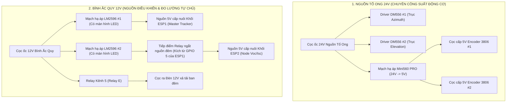

# THIẾT KẾ PHẦN CỨNG & BẢNG ÁNH XẠ CHÂN BO MẠCH PCB TOÀN HỆ THỐNG
## BO ĐIỀU KHIỂN & ĐO KIỂM ALL-IN-ONE (2 ESP32-S3 + RELAY 6 KÊNH)

Tài liệu này chuẩn hóa toàn bộ thiết kế bo mạch PCB tổng tích hợp **CẢ 2 VI ĐIỀU KHIỂN ESP32-S3**, module **Relay 6 kênh**, **2 mạch INA226**, **2 mạch ACS712**, **2 mạch FZ0430**, **RTC DS3231**, và **3 mạch hạ áp (2 LM2596 LED + 1 Mini560 Pro)** trên cùng một bo mạch mẹ.

---

## 1. SƠ ĐỒ PHÂN CẤP NGUỒN TOÀN HỆ THỐNG (POWER ARCHITECTURE)

Hệ thống sử dụng **2 nguồn cấp độc lập** để đảm bảo chống nhiễu tuyệt đối giữa động cơ công suất lớn và khối điều khiển/đo lường:

---

## 2. BẢNG PHÂN BỔ LINH KIỆN TRÊN BO MẠCH PCB VÀ NGOÀI PCB

| Nhóm | Tên linh kiện / Module | Vị trí | Dạng chân hàn / Kết nối | Chức năng chi tiết |
| :--- | :--- | :---: | :--- | :--- |
| **Khối MCU 1** | **ESP32-S3 DevKitC-1 #1** | **TRÊN PCB** | 2 hàng rào cái (Socket) 22-Pin | Điều khiển thuật toán Tracker (NOAA, Fuzzy-PID, PSO, RTC) |
| | **INA226 #1 (Tấm Xoay)** | **TRÊN PCB** | Header cái 4-Pin / 10-Pin | Đo điện áp, dòng điện, công suất tấm xoay (I2C `0x40`) |
| | **INA226 #2 (Tấm Cố Định)** | **TRÊN PCB** | Header cái 4-Pin / 10-Pin | Đo điện áp, dòng điện, công suất tấm cố định (I2C `0x41` / `0x44`) |
| | **RTC DS3231 (ZS-042)** | **TRÊN PCB** | Header cái 6-Pin | Đồng hồ thời gian thực + Pin CR2032 + Ngắt SQW |
| | **Mini560 PRO** | **TRÊN PCB** | 4 Pad hàn (IN+, IN-, OUT+, OUT-) | Hạ áp 24V tổ ong $\to$ 5V cấp cho 2 Encoder ngoài |
| | **LM2596 có màn hình #1** | **TRÊN PCB** | 4 Pad hàn / Cọc cắm | Hạ áp 12V Ắc quy $\to$ 5V cấp nuôi ESP1 và cảm biến |
| **Ngoại vi ESP1** | **Driver DM556 #1 & #2** | **TRÊN PCB** | Cọc vít Terminal KF301-3P | Chân phát xung PUL, DIR và GND ra Driver |
| | **2 Động cơ NEMA 23** | **NGOÀI PCB** | Cọc vít vặn dây pha A/B | Gắn trực tiếp trên khung giàn pin |
| | **2 Encoder Autonics 3806** | **NGOÀI PCB** | Cọc vít KF301-4P | Gắn trên trục motor, cấp nguồn 5V từ Mini560, trở kéo 6.2k/10k |
| | **2 Công tắc Home** | **NGOÀI PCB** | Cọc vít KF301-2P | Công tắc cữ Home Azimuth (G18) & Elevation (G21) kèm tụ 100nF |
| | **Cụm 4 cảm biến TEMT6000** | **NGOÀI PCB** | Cổng Jack 6-Pin (JST-XH/KF2510)| Gắn trên đỉnh giàn pin, nối về qua cáp bẹ 6 sợi |
| **Khối MCU 2** | **ESP32-S3 DevKitC-1 #2** | **TRÊN PCB** | 2 hàng rào cái (Socket) 22-Pin | Điều khiển đo hở mạch Voc, ngắn mạch Isc và phụ tải đêm |
| | **Module Relay 6 kênh** | **TRÊN PCB** | Header điều khiển + Cọc COM/NO | Đóng ngắt chu kỳ Voc/Isc, Đèn 12V và ngắt nguồn ESP2 |
| | **ACS712 #1 (Tấm Xoay)** | **TRÊN PCB** | Header 3P + Cọc đo tải | Đo dòng ngắn mạch Isc Tấm Xoay (GPIO 7 qua cầu 10k/20k) |
| | **ACS712 #2 (Tấm Cố Định)** | **TRÊN PCB** | Header 3P + Cọc đo tải | Đo dòng ngắn mạch Isc Tấm Cố Định (GPIO 5 qua cầu 10k/20k) |
| | **FZ0430 #1 (Tấm Xoay)** | **TRÊN PCB** | Header 2P + Cọc đo áp | Đo áp hở mạch Voc Tấm Xoay (GPIO 6) |
| | **FZ0430 #2 (Tấm Cố Định)** | **TRÊN PCB** | Header 2P + Cọc đo áp | Đo áp hở mạch Voc Tấm Cố Định (GPIO 4) |
| | **LM2596 có màn hình #2** | **TRÊN PCB** | 4 Pad hàn / Cọc cắm | Hạ áp 12V Ắc quy $\to$ 5V cấp nuôi toàn bộ Khối ESP2 |
| | **DS18B20 #1 (Nhiệt Độ Tấm Xoay)** | **TRÊN PCB** | Cọc vít Phoenix MKDS 3-Pin | Cấp 3.3V, đọc nhiệt độ 1-Wire tấm pin Xoay (GPIO 4) |
| | **DS18B20 #2 (Nhiệt Độ Cố Định)** | **TRÊN PCB** | Cọc vít Phoenix MKDS 3-Pin | Cấp 3.3V, đọc nhiệt độ 1-Wire tấm pin Cố định (GPIO 5) |
| **Ngoại vi ESP2** | **Đèn 12V xả ban đêm** | **NGOÀI PCB** | Cọc vít KF301-2P | Phụ tải ban đêm luân phiên 15 phút BẬT / 15 phút TẮT |

---

## 3. BẢNG ÁNH XẠ CHÂN CHI TIẾT (FULL PINOUT MATRIX CHO CẢ 2 ESP32-S3)

### A. Vi điều khiển 1: ESP32-S3 DevKitC-1 #1 (Master Solar Tracker)

| Chân ESP32 #1 | Tên tín hiệu | Ngoại vi kết nối | Loại tín hiệu | Trở kéo / Tụ phối hợp trên PCB |
| :---: | :--- | :--- | :---: | :--- |
| **GPIO 10** | `M1_PUL` | Driver DM556 #1 (Trục Azimuth) | Digital Out | Nối cọc KF301 ra chân `PUL+` |
| **GPIO 11** | `M1_DIR` | Driver DM556 #1 (Trục Azimuth) | Digital Out | Nối cọc KF301 ra chân `DIR+` |
| **GPIO 12** | `M2_PUL` | Driver DM556 #2 (Trục Elevation) | Digital Out | Nối cọc KF301 ra chân `PUL+` |
| **GPIO 13** | `M2_DIR` | Driver DM556 #2 (Trục Elevation) | Digital Out | Nối cọc KF301 ra chân `DIR+` |
| **GPIO 6** | `M1_ENC_A` | Encoder 1 (Azimuth) - Dây Trắng | Digital In (PCNT) | **Trở kéo 6.2kΩ / 10kΩ lên 3.3V** |
| **GPIO 7** | `M1_ENC_B` | Encoder 1 (Azimuth) - Dây Xanh | Digital In (PCNT) | **Trở kéo 6.2kΩ / 10kΩ lên 3.3V** |
| **GPIO 16** | `M2_ENC_A` | Encoder 2 (Elevation) - Dây Trắng| Digital In (PCNT) | **Trở kéo 6.2kΩ / 10kΩ lên 3.3V** |
| **GPIO 17** | `M2_ENC_B` | Encoder 2 (Elevation) - Dây Xanh | Digital In (PCNT) | **Trở kéo 6.2kΩ / 10kΩ lên 3.3V** |
| **GPIO 18** | `M1_HOME` | Công tắc hành trình Home Azimuth | Digital In (Pullup)| **Tụ lọc chống nảy tiếp điểm 100nF** |
| **GPIO 21** | `M2_HOME` | Công tắc hành trình Home Elevation | Digital In (Pullup)| **Tụ lọc chống nảy tiếp điểm 100nF** |
| **GPIO 8** | `I2C_SDA` | INA226 #1, INA226 #2, RTC DS3231| I2C Data | **Trở kéo 6.2kΩ / 10kΩ lên 3.3V** |
| **GPIO 9** | `I2C_SCL` | INA226 #1, INA226 #2, RTC DS3231| I2C Clock | **Trở kéo 6.2kΩ / 10kΩ lên 3.3V** |
| **GPIO 47** | `RTC_SQW` | Ngắt báo thức DS3231 Alarm 1 | Ext Interrupt | Kéo ngắt thức dậy lúc 06:16 AM |
| **GPIO 1** | `TEMT_TOP` | Cảm biến quang trên (Ngửa) | ADC1_CH0 | Tụ lọc RF 10nF xuống GND |
| **GPIO 2** | `TEMT_BOT` | Cảm biến quang dưới (Hạ) | ADC1_CH1 | Tụ lọc RF 10nF xuống GND |
| **GPIO 3** | `TEMT_LFT` | Cảm biến quang trái (Đông/Tây) | ADC1_CH2 | Tụ lọc RF 10nF xuống GND |
| **GPIO 4** | `TEMT_RGT` | Cảm biến quang phải (Đông/Tây) | ADC1_CH3 | Tụ lọc RF 10nF xuống GND |
| **GPIO 5** | `ESP1_CUT_ESP2`| Điều khiển ngắt nguồn nuôi ESP2 | Digital Out | Đưa sang kích Relay ngắt đêm |

---

### B. Vi điều khiển 2: ESP32-S3 DevKitC-1 #2 (Node đo Voc/Isc & Tấm Cố Định)

| Chân ESP32 #2 | Tên tín hiệu | Ngoại vi kết nối | Loại tín hiệu | Phối hợp trở kháng |
| :---: | :--- | :--- | :---: | :--- |
| **GPIO 6** | `VOC_TRK` | FZ0430 #1 (Áp hở mạch Tấm Xoay) | ADC1_CH5 | Đo dải 0 - 25V (qua cầu chia 5:1 nội FZ0430) |
| **GPIO 7** | `ISC_TRK` | ACS712 #1 (Dòng ngắn mạch Tấm Xoay)| ADC1_CH6 | **Đã hàn cầu phân áp 10k/20k hạ áp về dải 3.3V** |
| **GPIO 4** | `TEMP_TRK`| DS18B20 #1 (Nhiệt độ Tấm Xoay) | 1-Wire Digital In | Cấp 3.3V từ ESP2, trở kéo 4.7k trên module |
| **GPIO 5** | `TEMP_STA`| DS18B20 #2 (Nhiệt độ Tấm Cố Định)| 1-Wire Digital In | Cấp 3.3V từ ESP2, trở kéo 4.7k trên module |
| **GPIO 15**| `VOC_STA` | FZ0430 #2 (Áp hở mạch Tấm Cố Định) | ADC1_CH3 | Đo dải 0 - 25V |
| **GPIO 16**| `ISC_STA` | ACS712 #2 (Dòng ngắn mạch Tấm Cố Định)| ADC1_CH4| **Đã hàn cầu phân áp 10k/20k hạ áp về dải 3.3V** |
| **GPIO 14** | `RL_A_CUT` | Relay Kênh 1 (Ngắt tải sạc Tấm Xoay) | Digital Out | Active LOW (Kích mở tải đo Voc) |
| **GPIO 40** | `RL_C_CUT` | Relay Kênh 2 (Ngắt tải sạc Cố Định) | Digital Out | Active LOW (Kích mở tải đo Voc) |
| **GPIO 41** | `RL_B_ISC` | Relay Kênh 3 (Đóng ngắn mạch Tấm Xoay)| Digital Out | Active LOW (Kích ngắn mạch qua ACS712 đo Isc) |
| **GPIO 39** | `RL_D_ISC` | Relay Kênh 4 (Đóng ngắn mạch Cố Định)| Digital Out | Active LOW (Kích ngắn mạch qua ACS712 đo Isc) |
| **GPIO 42** | `RL_E_LAMP`| Relay Kênh 5 (Đèn 12V phụ tải đêm) | Digital Out | Active LOW (15p BẬT / 15p TẮT luân phiên khi ngủ) |
| - | `RL_K6_PWR` | Relay Kênh 6 (Ngắt nguồn ESP2 đêm) | Power Switch | **Nhận tín hiệu điều khiển từ GPIO 5 của ESP1** |

---

## 4. QUY CHUẨN ĐƯỜNG MẠCH (TRACE WIDTH) VÀ LỖ VIA AN TOÀN

Để bo mạch vận hành bền bỉ ngoài trời nhiều năm, các đường mạch đồng được tính toán chuẩn theo tiêu chuẩn IPC-2221:

1. **Đường nguồn 24V Nguồn Tổ Ong (Cấp 2 Driver DM556 dòng tới 6A - 8A):**
   * Độ rộng đường mạch: **$\ge 2.5\text{mm} - 3.0\text{mm}$** hoặc phủ **Power Copper Pour**.
   * Lỗ via chuyển lớp công suất: Đường kính ngoài $1.5\text{mm}$, lỗ khoan $0.8\text{mm}$ (mỗi điểm chịu dòng đặt chùm 3 - 4 via song song).
2. **Đường nguồn 12V Ắc Quy & 5V ra sau LM2596 (Dòng 2A - 3A):**
   * Độ rộng đường mạch: **$1.2\text{mm} - 1.5\text{mm}$**.
   * Lỗ via: Đường kính ngoài $1.2\text{mm}$, lỗ khoan $0.6\text{mm}$.
3. **Đường nguồn 3.3V nuôi cảm biến & Logic:**
   * Độ rộng đường mạch: **$0.6\text{mm} - 0.8\text{mm}$**.
4. **Đường tín hiệu Xung motor (PUL, DIR), Tín hiệu Encoder (A, B) & I2C:**
   * Độ rộng đường mạch: **$0.35\text{mm} - 0.4\text{mm}$**.
   * Khoảng cách cách ly (Clearance): **$\ge 0.35\text{mm}$**.
   * Đường phát xung DM556 đi tách biệt tối thiểu $2\text{mm}$ so với đường Analog TEMT6000 và tín hiệu ADC để chống nhiễu xuyên âm (Cross-talk).
5. **Mặt tiếp địa GND (GND Ground Plane):**
   * Phủ đồng tiếp địa toàn bộ mặt dưới (Bottom Layer) và các khoảng trống mặt trên (Top Layer) để chắn sóng bức xạ điện từ EMI từ động cơ bước.
