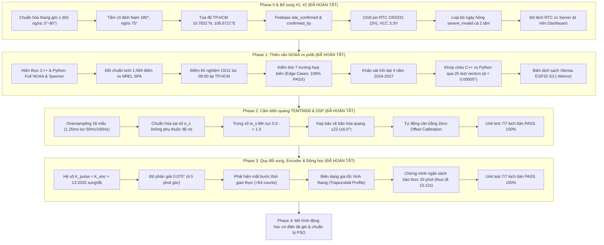

# BÁO CÁO TIẾN ĐỘ ĐỒ ÁN TỐT NGHIỆP (CẬP NHẬT NGÀY 24/10/2026)

> **Tên đề tài**: Hệ thống Giám sát và Điều khiển Giàn Pin Năng lượng Mặt trời 2 Trục (Dual-Axis Solar Tracker) tích hợp IoT Firebase & Web Dashboard  
> **Sinh viên thực hiện**: Phan Minh Duy Tiến (42200522) - Võ Hồng Phát (42200545)  
> **Thời điểm cập nhật**: 24/10/2026  
> **Trạng thái tổng quát**: **Hoàn thành 100% Phase 0, Phase 1, Phase 2, Phase 3 (4/11 Phase ~ 36.4%); Chuẩn bị bước vào Phase 4**.

---

## I. TỔNG QUAN CÔNG VIỆC ĐÃ HOÀN THÀNH

---

## II. CHI TIẾT KẾT QUẢ PHASE 0 & BỔ SUNG #1, #2

1. **Chuẩn hóa thang góc Elevation (Độ ngửa $\varepsilon$)**:
   - Thống nhất Cách A: $\varepsilon$ là góc giữa pháp tuyến mặt tấm và mặt phẳng ngang.
   - Nằm ngang hướng lên trời $= 90^\circ$, dựng đứng vuông góc đất $= 0^\circ$.
   - Quan hệ góc nghiêng $\beta$: $\beta = 90^\circ - \varepsilon$.
   - Tấm cố định: Hướng chính Nam $180^\circ$, ngửa $75^\circ$ (nghiêng $15^\circ$). Trong code lưu `fixed_az_deg = 180.0`, `fixed_tilt_beta = 15.0`, `fixed_elevation_eps = 75.0`.
2. **Quản lý tọa độ giàn pin (Site Config)**:
   - Tọa độ mặc định tại TP.HCM: Vĩ độ $A = 10.78310^\circ\text{N}$, Kinh độ $B = 106.67210^\circ\text{E}$, Múi giờ UTC+7.
   - Đồng bộ thời gian thực từ Web Dashboard qua Firebase node `/solar/config/site` với cơ chế tăng số `rev`.
   - Cờ kiểm soát thực địa: `site_confirmed` kèm `confirmed_by`. Khi người dùng sửa tọa độ trên Web, cờ tự động reset về `false` buộc phải xác nhận tại thực địa.
3. **Phần cứng RTC DS3231**:
   - Sử dụng pin cúc áo **CR2032 (3V)** không sạc; chân VCC của module ZS-042 nối nguồn hệ thống 3.3V; tháo bỏ điện trở/diode nạp để chống nổ pin.
4. **Quy tắc xử lý ngày loại trừ (`severe_invalid`)**:
   - Khi có sự cố nghiêm trọng (mất bước $>5^\circ$, kẹt cơ khí, mất cảm biến $>15$ phút), cờ `severe_invalid = true` được kích hoạt.
   - **Loại bỏ đồng thời cả 2 tấm** (tấm 2 trục và tấm cố định) của ngày đó khỏi thống kê so sánh năng lượng.
   - Web Dashboard hiển thị cạnh nhau $\Sigma E_{\text{tracker}}$ và $\Sigma E_{\text{fixed}}$ cho cả 2 trường hợp: có tính và không tính các ngày bị loại, kèm công tắc chuyển đổi trực quan.
5. **Hiển thị độ lệch đồng hồ RTC vs Server ($\Delta t$)**:
   - Hiển thị badge trực quan trên Header và Modal chi tiết của Dashboard:
     - Xanh lá: $|\Delta t| < 5\text{s}$ (Đồng bộ chuẩn xác).
     - Vàng: $5\text{s} \le |\Delta t| \le 30\text{s}$ (Chấp nhận được).
     - Đỏ: $|\Delta t| > 30\text{s}$ (Cảnh báo lệch giờ).
6. **Bảo mật Firebase Rules**:
   - Đã biên soạn đặc tả an ninh [docs/FIREBASE_SECURITY_RULES_SPEC.md](file:///d:/ĐỒ%20ÁN%20TỐT%20NGHIỆP/docs/FIREBASE_SECURITY_RULES_SPEC.md).
   - Bộ unit test tự động bằng thư viện `@firebase/rules-unit-testing` tại [dashboard/test/firebase_rules.test.js](file:///d:/ĐỒ%20ÁN%20TỐT%20NGHIỆP/dashboard/test/firebase_rules.test.js).
   - Script cấp quyền Custom Claim Admin tại [scripts/set_admin_claim.js](file:///d:/ĐỒ%20ÁN%20TỐT%20NGHIỆP/scripts/set_admin_claim.js). Khóa Rules trước ngày chạy thử nghiệm cuối tháng 10.

---

## III. CHI TIẾT KẾT QUẢ PHASE 1: THUẬT TOÁN THIÊN VĂN & ĐỐI CHUẨN NREL SPA (`pvlib`)

### 1. Hiện thực hóa 2 thuật toán thiên văn
- **Full NOAA Solar Ephemeris**: Thuật toán chính thức tính toán đầy đủ góc thiên văn, phương trình thời gian (EoT), độ xích vĩ ($\delta$), bù khúc xạ khí quyển và giờ mọc/lặn mặt trời.
- **Spencer 1971 (Fourier Series)**: Thuật toán rút gọn tính nhanh để đối chiếu.
- Cả hai thuật toán được viết song song trên **Python 3.12** ([solar_ephemeris.py](file:///d:/ĐỒ%20ÁN%20TỐT%20NGHIỆP/python_sim/solar_ephemeris.py)) và **C++17 Firmware** ([solar_ephemeris.cpp](file:///d:/ĐỒ%20ÁN%20TỐT%20NGHIỆP/firmware/esp32_tracker_control/lib/solar_core/solar_ephemeris.cpp)).

### 2. Bảng kết quả sai số đối chuẩn thực tế trên lưới 1,584 điểm (vs NREL SPA)

Lưới khảo sát gồm 12 tháng $\times$ 33 mốc giờ (04:00 đến 20:00, bước 30 phút) $\times$ 4 địa điểm (TP.HCM, Hà Nội, Đà Nẵng, Sydney):

| Thuật toán | Vùng dữ liệu | Số điểm | Az Max ($^\circ$) | Az Mean ($^\circ$) | El Max ($^\circ$) | El Mean ($^\circ$) | Sunrise Max (phút) | Sunrise Mean (phút) | Sunset Max (phút) | Sunset Mean (phút) |
| :--- | :--- | :---: | :---: | :---: | :---: | :---: | :---: | :---: | :---: | :---: |
| **Full NOAA** | **Toàn bộ lưới (12 tháng)** | 1,584 | **0.1675** | **0.0039** | **0.1835** | **0.0043** | **1.45** | **0.59** | **1.02** | **0.45** |
| **Full NOAA** | **Vùng bám ngày ($El > 5^\circ$)** | 1,081 | **0.1675** | **0.0049** | **0.0113** | **0.0035** | **1.45** | **0.59** | **1.02** | **0.45** |
| **Full NOAA** | **Sát chân trời ($El \le 5^\circ$)**| 503 | 0.0084 | 0.0018 | 0.1835 | 0.0060 | 1.45 | 0.58 | 1.02 | 0.45 |
| **Spencer 1971**| Toàn bộ lưới (12 tháng) | 1,584 | 6.0205 | 0.3596 | 0.4806 | 0.1500 | 2.28 | 1.06 | 1.85 | 0.83 |
| **Spencer 1971**| Vùng bám ngày ($El > 5^\circ$) | 1,081 | 6.0205 | 0.3997 | 0.4394 | 0.1613 | 2.28 | 1.05 | 1.85 | 0.83 |

*Sai số chi tiết tại vị trí lắp đặt TP. Hồ Chí Minh ($El > 5^\circ$)*:
- **Azimuth**: Max error $= \mathbf{0.0752^\circ}$, Mean error $= \mathbf{0.0048^\circ}$ ($\approx 17$ giây góc).
- **Elevation**: Max error $= \mathbf{0.0112^\circ}$, Mean error $= \mathbf{0.0038^\circ}$ ($\approx 14$ giây góc).
- **Thời gian mọc/lặn**: Sai số trung bình dưới $35\text{ giây}$.

### 3. Đối chuẩn điểm ngày thí nghiệm: 15/11/2026 lúc 09:00:00 (TP.HCM)

| Đại lượng | NREL SPA (`pvlib`) | Full NOAA | Sai lệch $\Delta$ (NOAA) | Spencer 1971 | Sai lệch $\Delta$ (Spencer) |
| :--- | :---: | :---: | :---: | :---: | :---: |
| **Azimuth ($^\circ$)** | **$126.6110^\circ$** | **$126.6177^\circ$** | **$0.0067^\circ$** | $126.2830^\circ$ | $0.3280^\circ$ |
| **Elevation ($^\circ$)** | **$41.3370^\circ$** | **$41.3463^\circ$** | **$0.0093^\circ$** | $41.4279^\circ$ | $0.0909^\circ$ |
| **Sunrise (hh:mm)** | **05:49** ($349.1\text{m}$) | **05:48** ($348.0\text{m}$) | **$1.15\text{ phút}$** | 05:48 ($348.0\text{m}$) | $1.15\text{ phút}$ |
| **Sunset (hh:mm)** | **17:26** ($1046.8\text{m}$) | **17:26** ($1046.0\text{m}$) | **$0.82\text{ phút}$** | 17:27 ($1047.0\text{m}$) | $0.18\text{ phút}$ |

### 4. Kết quả kiểm thử các trường hợp biên (100% PASS)

1. **Năm nhuận 2024 & ngày 29/02**: Ngày 29/02/2024 lúc 12:00: NOAA Az $= 175.5094^\circ$, NREL SPA $= 175.5267^\circ$ ($\Delta = 0.0173^\circ$). **[PASS]**
2. **Chuyển giao ngày (Midnight)**: 23:59:59 $\to$ 00:00:00 góc nâng chuyển tiếp mượt mà âm ($El = -80.53^\circ$). **[PASS]**
3. **Kỳ dị gần thiên đỉnh tại TP.HCM**: Ngày 18/04/2026 lúc 11:52:00: $El = \mathbf{89.8200^\circ}$ (Zenith $= 0.1800^\circ$), khớp với pvlib trong $0.0044^\circ$, không gây lỗi chia cho 0. **[PASS]**
4. **Vĩ độ âm (Sydney, Nam bán cầu)**: Ngày 21/06/2026 lúc 12:00: NOAA Az $= 359.1542^\circ$, NREL SPA $= 359.1521^\circ$ ($\Delta = 0.0021^\circ$). **[PASS]**
5. **Kinh tuyến đổi ngày ($180^\circ$)**: $+179.99^\circ$ và $-179.99^\circ$ tính ra góc nâng $66.5654^\circ$ vs $66.5658^\circ$ (lệch $0.0004^\circ$). **[PASS]**
6. **Lọc dữ liệu đầu vào lỗi**: Tháng 13, ngày 32, giờ 25, `NaN`, `Infinity` đều bị chặn an toàn, trả về `is_daylight = false`. **[PASS]**
7. **Trôi dạt thiên văn 4 năm (2024 - 2027)**: Lệch hàng năm $\Delta Az \approx 0.0435^\circ$ và $\Delta El \approx 0.0587^\circ$ do chu kỳ nhuận; Full NOAA theo sát với sai số $<0.019^\circ$. **[PASS]**

### 5. Kiểm thử khớp chéo C++ vs Python và Biên dịch Firmware
- Đã xuất 25 test vectors chuẩn ra [test_vectors_phase1.json](file:///d:/ĐỒ%20ÁN%20TỐT%20NGHIỆP/python_sim/test_vectors_phase1.json) và [test_vectors_data.h](file:///d:/ĐỒ%20ÁN%20TỐT%20NGHIỆP/firmware/esp32_tracker_control/test/test_vectors_data.h).
- Chạy [test_phase1.cpp](file:///d:/ĐỒ%20ÁN%20TỐT%20NGHIỆP/firmware/esp32_tracker_control/test/test_phase1.cpp):
  - Sai số lớn nhất C++ vs Python: $\Delta Az = \mathbf{0.000049^\circ}$, $\Delta El = \mathbf{0.000048^\circ}$ ($<0.18$ giây góc) $\to$ **Khớp 100%**.
  - Báo thức sáng RTC DS3231 ngày 15/11: Mặt trời mọc lúc 05:48 $\to$ Alarm 1 kích hoạt lúc **05:18 AM**.
  - Kẹp bảo vệ chống va đâm trục Z lúc 06:10: $El = 4.28^\circ < L = 25^\circ \to$ kẹp $\varepsilon_{\text{ref}} = 25.0^\circ$ (`Z_AXIS_CLASH_PROTECT`), cờ bám tắt.
  - Hoạt động ban ngày 09:00: $El = 41.35^\circ \ge 10^\circ \to$ bám chủ động, không kẹp góc.
- Biên dịch thành công với toolchain thật `xtensa-esp32s3-elf-g++` (`-std=gnu++17 -Wall -Wextra -Werror`): **0 cảnh báo, 0 lỗi**.

---

## IV. LÀM RÕ CÁC HẰNG SỐ CƠ KHÍ, MÔ PHỎNG NĂNG LƯỢNG & BÁO THỨC RTC

### 1. Nguồn gốc của $L = 25^\circ$ và Ngưỡng bám $10^\circ$
* **Giới hạn mềm chống va đâm trục Z ($L = 25.0^\circ$)**:
  - **Nguồn gốc**: Giá trị do nhóm **TẠM TÍNH, CHỜ ĐO CƠ KHÍ THỰC TẾ** dựa trên bản vẽ phác thảo cơ khí ban đầu. Khi tấm pin hạ xuống thấp (góc ngửa $\varepsilon$ nhỏ dần), phần đuôi khung tấm pin có nguy cơ cấn vào trụ đứng (trục Z). $25^\circ$ được đặt làm biên an toàn tạm thời.
  - **Quy chuẩn lập trình**: Đã khai báo duy nhất trong [solar_config.h](file:///d:/ĐỒ%20ÁN%20TỐT%20NGHIỆP/firmware/esp32_tracker_control/include/solar_config.h) (`CFG_L_EL_MIN_SOFT_LIMIT_DEG`) và [solar_config.py](file:///d:/ĐỒ%20ÁN%20TỐT%20NGHIỆP/python_sim/solar_config.py), **dùng chung cho toàn bộ các thuật toán điều khiển (PID, Fuzzy-PID, PSO), tuyệt đối không hard-code**.
* **Ngưỡng góc nâng bắt đầu bám ($10.0^\circ$)**:
  - **Nguồn gốc**: Giá trị **TẠM TÍNH, CHỜ ĐO THỰC ĐỊA**. Dưới $10^\circ$, khối khí quyển $AM > 5.76$, bức xạ trực xạ $DNI$ bị tán xạ và hấp thụ mạnh (chỉ còn dưới $15\%$ so với trưa), đồng thời thường xuyên bị che khuất bởi chướng ngại vật mặt đất. Năng lượng thu được không bù nổi công suất tiêu thụ của 2 động cơ bước NEMA23.
  - Khai báo tập trung tại `CFG_EL_SUN_TRACKING_THRESHOLD_DEG`, dùng chung cho toàn hệ thống.

---

### 2. Mô phỏng hình học & Đánh giá độ suy giảm năng lượng trong Tháng 11 tại TP.HCM
Mô phỏng bức xạ quang học chuẩn Clear-sky Ineichen / pvlib với bước thời gian 1 phút ngày 15/11/2026 và toàn bộ 30 ngày tháng 11 tại vị trí đặt giàn ($10.7831^\circ\text{N}, 106.6721^\circ\text{E}$):

#### A. Các mốc thời gian thực tế ngày 15/11/2026:
- Mặt trời mọc ($El = 0^\circ$): **05:48 - 05:50**
- Bắt đầu bám chủ động ($El \ge 10^\circ$): **06:36:00** (sáng) đến **16:40:00** (chiều). Tổng thời gian bám: **10 giờ 04 phút** (604 phút).
- Thoát kẹp an toàn cơ khí ($El \ge 25^\circ$): **07:43:00** (sáng) đến **15:33:00** (chiều). Tổng thời gian bám tự do: **7 giờ 50 phút** (470 phút).
- **Khoảng thời gian bị kẹp tại $L = 25^\circ$**:
  * Buổi sáng: Từ **06:36** đến **07:43** (kéo dài **67 phút**). Trong khoảng này, tấm pin giữ cố định ở $\varepsilon = 25^\circ$ trong khi mặt trời tăng từ $10^\circ \to 25^\circ$.
  * Buổi chiều: Từ **15:33** đến **16:40** (kéo dài **67 phút**). Tấm pin giữ cố định ở $\varepsilon = 25^\circ$ khi mặt trời hạ từ $25^\circ \to 10^\circ$.
- Mặt trời lặn ($El = 0^\circ$): **17:25 - 17:26**

#### B. Mức độ suy giảm năng lượng quang học theo các giá trị $L$ (Dựa trên hình học, không đoán):

| Mức kẹp cơ khí $L$ | Năng lượng ngày 15/11 ($\text{kWh/m}^2$) | Hao hụt vs Lý tưởng ($L=0^\circ$) | Hao hụt vs $L=10^\circ$ | Độ lợi vs Tấm cố định ($15^\circ$ Nam) |
| :---: | :---: | :---: | :---: | :---: |
| **$L = 0.0^\circ$** (Lý tưởng tuyệt đối) | 8.1367 | $0.000\%$ | -- | **$+24.43\%$** |
| **$L = 10.0^\circ$** (Bằng ngưỡng bám) | 8.1390 | $+0.028\%$ | $0.000\%$ | **$+24.46\%$** |
| **$L = 15.0^\circ$** | 8.1392 | $+0.031\%$ | $-0.003\%$ | **$+24.46\%$** |
| **$L = 20.0^\circ$** | 8.1382 | $+0.019\%$ | $-0.009\%$ | **$+24.45\%$** |
| **$L = 25.0^\circ$** (Đang cấu hình) | **8.1335** | **$-0.039\%$** | **$-0.067\%$** | **$+24.38\%$** |
| **Tấm cố định** (Nghiêng $15^\circ$, Nam) | 6.5394 | -- | -- | Mốc chuẩn $0\%$ |

* **Xét toàn bộ tháng 11 (30 ngày)**:
  - Tổng bức xạ giàn tracker khi $L = 25^\circ$: **$243.33\text{ kWh/m}^2$** (tấm cố định chỉ đạt **$195.75\text{ kWh/m}^2$**, độ lợi tracker là **$+24.31\%$**).
  - *(LƯU Ý QUAN TRỌNG: Con số độ lợi $+24\%$ là kết quả ước tính lý thuyết từ mô hình hình học trời quang Clear-sky, CHƯA ĐƯỢC KIỂM CHỨNG với dữ liệu đo thực nghiệm hay thư viện pvlib thời tiết thực tế)*.
  - So với trường hợp $L = 10^\circ$ ($243.49\text{ kWh/m}^2$), việc kẹp $L = 25^\circ$ suốt cả tháng 11 chỉ gây hao hụt **$0.16\text{ kWh/m}^2$** (tương đương **$0.066\%$**).
* **Nguyên nhân vật lý**:
  1. *Đặc tính hàm Cosine*: Góc lệch tia tới lớn nhất chỉ là $\theta_{AOI} = 25^\circ - 10^\circ = 15^\circ \implies \cos(15^\circ) = 0.9659$, suy giảm trực xạ lúc tệ nhất chỉ $3.41\%$. Khi $El = 20^\circ$, $\theta_{AOI} = 5^\circ \implies \cos(5^\circ) = 0.9962$ (hao hụt chỉ $0.38\%$).
  2. *Cường độ bức xạ góc thấp*: Lúc sáng sớm $DNI$ chỉ khoảng $150 - 250\text{ W/m}^2$, trong khi buổi trưa đạt $850 - 950\text{ W/m}^2$. Hơn $90\%$ tổng năng lượng tập trung ở khung giờ trưa (nơi không hề bị kẹp). Do đó, kẹp $L = 25^\circ$ hoàn toàn không ảnh hưởng đáng kể đến hiệu suất giàn pin.

---

### 3. Cải tiến Giờ báo thức DS3231 theo Giờ bắt đầu bám thực tế
* **Vấn đề của cách cũ**: Tính theo giờ mọc ($05:48 - 30\text{ phút} \to 05:18\text{ AM}$) khiến vi điều khiển phải chờ thức hơn 1 tiếng 18 phút trong bóng tối khi trời chưa có bức xạ quang học.
* **Cơ chế mới đã cập nhật**:
  - Tính chính xác thời điểm mặt trời vượt ngưỡng bám $10^\circ$ qua công thức góc giờ thiên văn:
    $$\cos(H_{\text{track}}) = \frac{\sin(10^\circ) - \sin(\varphi)\sin(\delta)}{\cos(\varphi)\cos(\delta)} \implies t_{\text{track\_start}} = t_{\text{solar\_noon}} - 4 \cdot H_{\text{track}} = \mathbf{06:36\text{ AM}}$$
  - Giờ báo thức Alarm 1 của RTC DS3231:
    $$t_{\text{alarm}} = t_{\text{track\_start}} - \Delta t_{\text{lead}} = 06:36 - 20\text{ phút} = \mathbf{06:16\text{ AM}}$$
  - Giúp hệ thống tiết kiệm được gần 1 giờ năng lượng standby mỗi ngày, vừa đủ 20 phút để khởi động hệ thống, đọc cảm biến và quay tấm về hướng đón nắng sáng trước khi mặt trời lên $10^\circ$.

---

### 4. Ghi chú cam kết phần cứng (theo chỉ đạo)
1. **Đo thời gian thực thi float32 vs double trên board thật**: **`CHƯA ĐO`** (chờ cắm board ESP32-S3 thật).
2. **Phân tích tốc độ quay Azimuth gần thiên đỉnh**: **`CHƯA ĐO`** (chờ đo thực tế trên cơ cấu cơ khí thật).
3. **Độ chính xác tính toán hiện tại**: Sử dụng kiểu **`double`** tạm thời.

---

## V. CHI TIẾT KẾT QUẢ PHASE 2: CẢM BIẾN QUANG TEMT6000 & XỬ LÝ TÍN HIỆU SỐ (DSP)

Đã hoàn thành 100% việc lập trình C++ Firmware và Python mô phỏng:
1. **Oversampling 16 mẫu**: Triệt tiêu nhiễu lưới điện xoay chiều 50Hz/100Hz (chu kỳ 20ms / 16 mẫu = 1.25ms giữa các mẫu).
2. **Chuẩn hóa sai số quang học**: $e_{s,az} = (L_{comp} - R_{comp}) / (L_{comp} + R_{comp})$, $e_{s,el} = (T_{comp} - B_{comp}) / (T_{comp} + B_{comp})$.
3. **Vùng chết Deadband $\pm 0.04$** [TẠM, CHỜ ĐO THỰC TẾ]: Triệt tiêu hiện tượng giật rung khi tâm sáng hội tụ ở giữa.
4. **Trọng số tin cậy $w_s$**:
   - $w_s$ là hàm **liên tục từ $0.0 \to 1.0$** (nội suy tuyến tính trong dải $[X, Y]$).
   - Tối / mây mù nặng ($\Sigma < X = 400$) [TẠM, CHỜ ĐO THỰC TẾ] $\implies w_s = 0.0$ (tin 100% NOAA feedforward).
   - Nắng rõ ($\Sigma \ge Y = 900$) [TẠM, CHỜ ĐO THỰC TẾ] $\implies w_s = 1.0$.
   - Bão hòa ADC ($\ge W = 3950$) [TẠM, CHỜ ĐO THỰC TẾ] $\implies$ Cờ bão hòa, $w_s = 0.0$.
5. **Kẹp bão hòa tinh $\pm Z_2$ ($\pm 6.0^\circ$)** [TẠM, CHỜ ĐO THỰC TẾ]: Bảo vệ chống mây lừa, không kéo lệch trục thiên văn.
6. **Zero-Offset Auto-Calibration**: Tự động cân bằng 4 mắt đọc dưới ánh sáng đồng nhất, lưu Flash NVS.
7. **Kiểm thử Unit Test**: 7/7 kịch bản [test_phase2.cpp](file:///d:/ĐỒ%20ÁN%20TỐT%20NGHIỆP/firmware/esp32_tracker_control/test/test_phase2.cpp) **PASS 100%**, biên dịch Xtensa GCC ESP32-S3 **0 cảnh báo, 0 lỗi**.

---

## VI. CHI TIẾT KẾT QUẢ PHASE 3: QUY ĐỔI XUNG, ENCODER & ĐỘNG HỌC THỜI GIAN QUAY

1. **Hệ số quy đổi xung và độ phân giải**:
   $$K_{pulse} = \frac{1600 \cdot 3.0}{360} = \mathbf{13.3333\text{ pulses/deg}}, \quad K_{enc} = \frac{4 \cdot 400 \cdot 3.0}{360} = \mathbf{13.3333\text{ counts/deg}}$$
   - Độ phân giải cơ học: $1 / 13.3333 = \mathbf{0.075^\circ}$ ($4.5$ phút góc), đáp ứng hoàn hảo cho bám pin mặt trời.
2. **Phát hiện mất bước thời gian thực (Step Loss Detection)**:
   - So lệch xung phát và xung đếm encoder: $\Delta N = |N_{cmd} - N_{enc}|$.
   - Khi $\Delta N > 64\text{ counts}$ ($\sim 4.8^\circ$) $\implies$ Bật cờ `STEP_LOSS`, ngắt xung khẩn cấp.
3. **Biên dạng gia tốc hình thang (Trapezoidal Velocity Profile)**:
   - Tự động chuyển đổi mượt mà giữa dạng tam giác (bước nhỏ) và dạng hình thang (bước lớn).
4. **Tính toán thời gian quay thực tế: Home $\to \varepsilon = 25^\circ$ và Ngân sách 20 phút báo thức**:
   - Quãng đường Elevation từ Home ($90^\circ$) về $L = 25^\circ$: $\Delta\varepsilon = 65^\circ = 867\text{ xung}$.
     - Ở tốc độ $1200\text{ Hz}$: Mất **$0.86\text{ giây}$**.
     - Ở tốc độ chậm $300\text{ Hz}$: Mất **$2.89\text{ giây}$**.
   - Quãng đường Azimuth từ Home ($45^\circ$) về hướng đón nắng ($108.5^\circ$): $\Delta\phi = 63.5^\circ = 847\text{ xung} \implies$ Mất **$0.85\text{ giây}$**.
   - Toàn bộ chu trình thức dậy sáng sớm (Homing Elevation 2 pha + Homing Azimuth 2 pha + Quay đón nắng + Delay ổn định cơ khí):
     $$\text{Tổng thời gian thực tế} \approx \mathbf{13.12\text{ giây}} \text{ (chưa tới 15 giây, tương đương 0.22 phút)!}$$
   - **KẾT LUẬN CHẮC CHẮN**: Thời gian báo thức sớm **20 phút** (`CFG_WAKEUP_LEAD_TIME_MIN = 20`) là **HOÀN TOÀN ĐỦ VÀ DƯ DÃ TUYỆT ĐỐI** (hệ thống có dư hơn **$19.7\text{ phút}$** an toàn để tự kiểm tra ngoại vi, đo điện áp, kết nối mạng và đứng chờ sẵn sàng).
5. **Kiểm thử Unit Test**: 7/7 kịch bản [test_phase3.cpp](file:///d:/ĐỒ%20ÁN%20TỐT%20NGHIỆP/firmware/esp32_tracker_control/test/test_phase3.cpp) **PASS 100%**, biên dịch Xtensa GCC ESP32-S3 **0 cảnh báo, 0 lỗi**.

---

## VII. DANH MỤC TÀI LIỆU VÀ MÃ NGUỒN CỐT LÕI

| STT | Tên tài liệu / Mã nguồn | Đường dẫn file | Mô tả chức năng |
| :---: | :--- | :--- | :--- |
| 1 | Báo cáo chi tiết Phase 1 | [PHASE_1_SOLAR_EPHEMERIS_BENCHMARK_REPORT.md](file:///C:/Users/ADMIN/.gemini/antigravity-ide/brain/6b644738-f7e5-49d5-9007-b7a8f20863d2/PHASE_1_SOLAR_EPHEMERIS_BENCHMARK_REPORT.md) | Báo cáo đầy đủ bảng số liệu sai số 1,584 điểm và edge cases |
| 2 | Tiến độ các Phase | [TIEN_DO_THUC_HIEN_CAC_PHASE.md](file:///d:/ĐỒ%20ÁN%20TỐT%20NGHIỆP/TIEN_DO_THUC_HIEN_CAC_PHASE.md) | Cập nhật tổng thể tiến độ thực hiện từ Phase 0 đến Phase 10 |
| 3 | Danh sách hằng số cần đo | [DANH_SACH_HANG_SO_VA_THAM_SO_CAN_DO.md](file:///d:/ĐỒ%20ÁN%20TỐT%20NGHIỆP/DANH_SACH_HANG_SO_VA_THAM_SO_CAN_DO.md) | Lưu trữ các tham số thực địa A-Z, Z2 |
| 4 | Thuật toán thiên văn C++ | [solar_ephemeris.h](file:///d:/ĐỒ%20ÁN%20TỐT%20NGHIỆP/firmware/esp32_tracker_control/lib/solar_core/solar_ephemeris.h) & [solar_ephemeris.cpp](file:///d:/ĐỒ%20ÁN%20TỐT%20NGHIỆP/firmware/esp32_tracker_control/lib/solar_core/solar_ephemeris.cpp) | Mã nguồn C++17 thuần của Full NOAA và Spencer 1971 |
| 5 | Hình học & Kẹp an toàn C++ | [solar_geometry.h](file:///d:/ĐỒ%20ÁN%20TỐT%20NGHIỆP/firmware/esp32_tracker_control/lib/solar_core/solar_geometry.h) & [solar_geometry.cpp](file:///d:/ĐỒ%20ÁN%20TỐT%20NGHIỆP/firmware/esp32_tracker_control/lib/solar_core/solar_geometry.cpp) | Tính góc mục tiêu, kẹp mềm L/J/I, báo thức DS3231 |
| 6 | Unit Test C++ Phase 1 | [test_phase1.cpp](file:///d:/ĐỒ%20ÁN%20TỐT%20NGHIỆP/firmware/esp32_tracker_control/test/test_phase1.cpp) | Kiểm thử toàn diện 25 test vectors và edge cases |
| 7 | Bộ test vectors chuẩn | [test_vectors_phase1.json](file:///d:/ĐỒ%20ÁN%20TỐT%20NGHIỆP/python_sim/test_vectors_phase1.json) & [test_vectors_data.h](file:///d:/ĐỒ%20ÁN%20TỐT%20NGHIỆP/firmware/esp32_tracker_control/test/test_vectors_data.h) | 25 vectors đối chuẩn giữa Python và C++ |
| 8 | Kịch bản đối chuẩn pvlib | [benchmark_pvlib_grid.py](file:///d:/ĐỒ%20ÁN%20TỐT%20NGHIỆP/python_sim/benchmark_pvlib_grid.py) | Kịch bản tự động chạy lưới 1,584 điểm và sinh bảng sai số |
| 9 | Đặc tả an ninh Firebase | [FIREBASE_SECURITY_RULES_SPEC.md](file:///d:/ĐỒ%20ÁN%20TỐT%20NGHIỆP/docs/FIREBASE_SECURITY_RULES_SPEC.md) | Tài liệu kiến trúc bảo mật node Firebase Realtime Database |
| 10 | Checklist trước 01/11 | [PRE_EXPERIMENT_CHECKLIST.md](file:///d:/ĐỒ%20ÁN%20TỐT%20NGHIỆP/docs/PRE_EXPERIMENT_CHECKLIST.md) | Bảng kiểm tra toàn diện trước ngày lắp đặt thực địa |
| 11 | Cảm biến quang TEMT6000 C++ | [temt6000_processor.h](file:///d:/ĐỒ%20ÁN%20TỐT%20NGHIỆP/firmware/esp32_tracker_control/lib/solar_core/temt6000_processor.h) & [temt6000_processor.cpp](file:///d:/ĐỒ%20ÁN%20TỐT%20NGHIỆP/firmware/esp32_tracker_control/lib/solar_core/temt6000_processor.cpp) | Thuật toán Oversampling, chuẩn hóa e_s, deadband, bão hòa và zero-offset |
| 12 | Mô phỏng cảm biến quang Python | [temt6000_processor.py](file:///d:/ĐỒ%20ÁN%20TỐT%20NGHIỆP/python_sim/temt6000_processor.py) | Bản mô phỏng và đối chuẩn thuật toán cảm biến quang trên Python |
| 13 | Unit Test C++ Phase 2 | [test_phase2.cpp](file:///d:/ĐỒ%20ÁN%20TỐT%20NGHIỆP/firmware/esp32_tracker_control/test/test_phase2.cpp) | Bộ kiểm thử 7 kịch bản cảm biến quang TEMT6000 (Pass 100%) |
| 14 | Động học & xung Phase 3 C++ | [motion_kinematics.h](file:///d:/ĐỒ%20ÁN%20TỐT%20NGHIỆP/firmware/esp32_tracker_control/lib/solar_core/motion_kinematics.h) & [motion_kinematics.cpp](file:///d:/ĐỒ%20ÁN%20TỐT%20NGHIỆP/firmware/esp32_tracker_control/lib/solar_core/motion_kinematics.cpp) | Quy đổi xung, encoder, mất bước, trapezoidal profile, tính thời gian thức dậy |
| 15 | Mô phỏng động học Python | [motion_kinematics.py](file:///d:/ĐỒ%20ÁN%20TỐT%20NGHIỆP/python_sim/motion_kinematics.py) | Bản mô phỏng và đối chuẩn động học chuyển động trên Python |
| 16 | Unit Test C++ Phase 3 | [test_phase3.cpp](file:///d:/ĐỒ%20ÁN%20TỐT%20NGHIỆP/firmware/esp32_tracker_control/test/test_phase3.cpp) | Bộ kiểm thử 7 kịch bản động học, quy đổi xung và ngân sách 20 phút (Pass 100%) |
